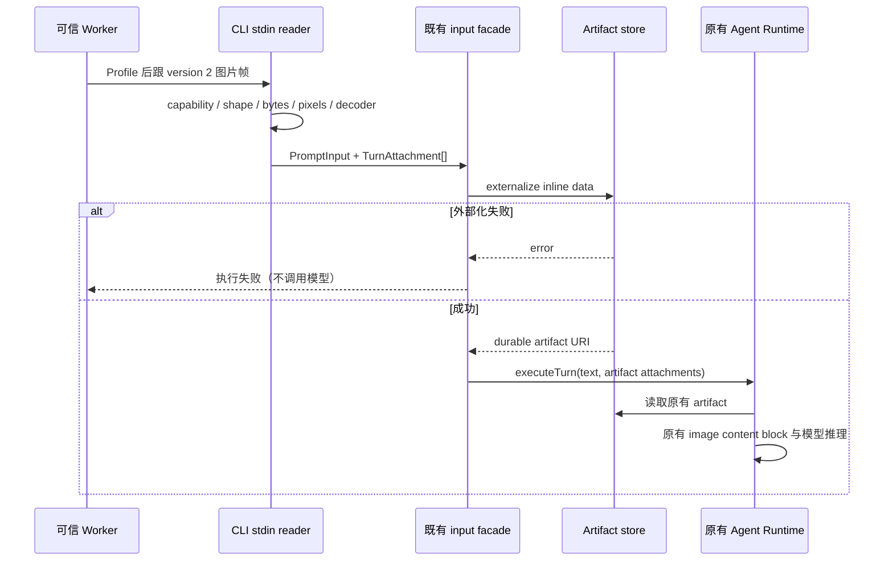
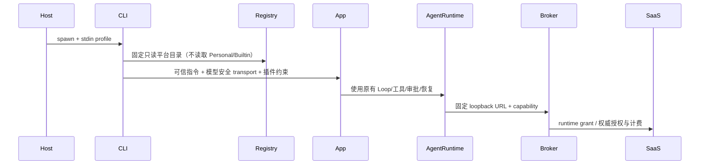

# 织流托管 Runtime 启动合同

状态：CLI 托管入口已实现并通过过程测试；Host/SaaS 联调与云部署由对应模块验收。普通 ZCode CLI 的配置、插件和模型行为保持兼容。

插件候选来源由 `adapters/plugins/discovery` adapter 负责：普通模式保留 inline → 显式官方目录 → bundled 当前缓存分片 → 已安装市场来源的既有顺序；`explicitPluginRootsOnly` 在 inline 来源后立即返回，不扫描官方、旧缓存或个人市场记录。此边界只决定候选路径，不重复拥有插件实例、权限、Hook 或运行状态；NodePluginAdapter 仍负责解析/启用/组合。抽离保持同步 API 与诊断行为，避免在超长入口继续堆叠来源策略。

## 单一所有者与启动

可信 Host/云 Worker 启动 `app-server --stdio --managed-profile-stdin`，或
`--managed-profile-stdin --prompt-stdin --output-format stream-json`。
stdin 第一行是 `ZhiliuManagedRuntimeProfile` JSON；仅启动时读取一次，不属于普通 RPC。
`--prompt-stdin` 第二行是 `{ "text": "用户需求" }`，用户正文与 capability 不进入 argv。
凭据只在内存；不写环境变量、配置文件、会话元数据、stdout 或日志。

### 版本 2 图片输入（受控传输，尚未开放云图片准入）

旧 `{text}` 帧仍返回原字符串；图片帧为严格的
`{version:2,text:"用户需求",images:[{mediaType:"image/png",data:"<canonical base64>"}]}`。
`mediaType` 只接受 PNG/JPEG；不接受 URL、路径、data URL、文件名或额外字段。
`text` 必须非空，图片数量 1–4，decoded 合计不超过 4 MiB，整条 UTF-8 NDJSON 行不超过
6 MiB（首行 Profile 仍是 1 MiB）。单图边长不超过 8192、像素不超过 16,000,000，
合计像素不超过 32,000,000。先以真实 magic 和 PNG IHDR / JPEG SOF0、SOF2 检查尺寸，
全部图片通过预算后，再逐个复用既有 ImageProcessorPort 解码；不能只凭扩展名或声明的 MIME
接纳。WebP 的现有实现是透传，尚不能作为真实解码验证，因此本版本拒绝 WebP。

只有可信启动 Profile 显式 `supportsImage:true` 才接纳版本 2；false 或缺省在读取帧时失败，
不会继续发送纯文本模型请求。模型目录从同一个冻结 Profile 读取 image capability：显式 false
关闭、true 开启；缺省只为旧桌面 Profile 保留历史 true 行为，不是新授权。生产云端本批显式 false，
历史、重新生成及新图片准入仍关闭，必须完成视觉上下文预算验收后另行灰度。

唯一输入路径是 stdin reader → 原有 `PromptInput` / `TurnAttachment` → input facade →
artifact store → 原有 Core 图片 content block → 原有模型 adapter。Reader 不取得宿主文件/网络权限，
不创建新会话、队列、模型请求或图片存储。托管模式 externalize 失败（缺 store、写失败或返回非法
artifact URI）必须在 executeTurn 前失败，不能移除 content 继续。普通本地模式保留已有兼容行为。

验收覆盖旧帧、分片/同 chunk 后续帧、显式能力、伪造格式、损坏图片、压缩炸弹预算、数量及字节
上限、artifact 失败、受控真实 CLI 到两种模型协议图片 block。受控测试不代表生产图片已可用。

Profile 由平台授权的 Host 生成：version=1，loopback gatewayBaseUrl，随机 capabilityToken，
modelId 固定 zhiliu-managed，protocol 为 responses 或 chat_completions，模型上下文/输出限额，
reasoningEffort，以及可选 instructions、pluginManifest.roots 和 toolAllowlist。
[] 明确禁止所有工具；undefined 保留桌面上游工具权限。云端必须显式传 [] 或受控工具集合，
并传 pluginManifest.roots=[]，使用独立 storage/cwd/HOME 和外部隔离运行器。

可选 `platformTools={url,capabilityToken,timeoutMs?}` 仅连接 `http://127.0.0.1:<随机端口>/mcp`。
工具 cap 必须独立于模型 cap；固定 serverName 为 zhiliu_platform。Bootstrap 生成无凭据的
HTTP/session-isolation/legacy MCP 配置并标记 alwaysLoad；可信 transport 闭包逐请求注入工具 cap，
拒绝配置替换、代理、重定向与 OAuth。只将平台发布 allowlist 中该 server 的精确工具名交给已有
PermissionService 放行网络交接，执行审批和扣费仍由 SaaS Run 快照及 lease epoch 做权威校验。
普通本地插件的工具和审批不变；空 manifest 仍不允许发现任何宿主 MCP。

MCP tools/call 沿现有 Agent Loop await，工具上下文把原始 toolCallId 作为 `_meta.tool_call_id`
（也在 com.zcode/request-context 中）发送。SaaS 以授权 Run + call id 幂等，不信任工具参数中的
用户/租户/Run。SDK 取消通知与 AbortSignal 沿原有链路，平台 server 禁自动重发未知工具。
服务端必须先写持久 ToolRequest 后等待，并可以发进度报告等待状态；工具完成后返回真正的 MCP
result，Loop 才继续推理，不能把「等待桌面」文字伪装成执行结果。

活跃 CLI 的 await 不等于跨进程冷恢复。进程崩溃且模型/工具可能已接受时必须进入显式
needs_reconciliation；在没有 pending-tool 恢复证据前，不得自动重跑原 prompt、模型或工具。

## 安全不变量

- 在任何 Provider 配置准备之前识别托管启动；跳过 Builtin、Personal、旧模型迁移与 dotenv。
- Registry 仅发布一个托管虚拟模型。主请求、子 Agent、标题、Compact、Workflow 共享同一模型工厂。
- 每次模型 HTTP 调用必须再次校验固定目标与协议路径，强制 capability 授权，禁重定向和请求级覆盖。
- 可信业务指令附加到现有指令材料，保留 ZCode 默认系统提示与工具规则，不整段覆盖 systemPrompt。
- pluginManifest 存在时，只加载 manifest 明确列出的插件根；不得自动发现宿主的个人/项目插件或技能。
- 云端无工具不等同于 OS 沙箱。平台运行器负责网络、文件、进程和资源的外部隔离。
- 网关负责权威计费；CLI UsageStore 仅作执行用量展示和对账，不作为扣费账本。
- 托管 adapter 强制 SingleAttempt，覆盖 workflow 的无上限 retry budget；主/子 runtime 禁止 partial-stream 自动恢复。已接收、状态不明或部分输出的物理请求失败后不得客户端自动重放；由服务端按幂等键协调可证明尚未接收的重试。
- Responses 强制 store=false，拒绝 previous_response_id/background。没有 reasoningEffort 时目录档位为 managed；SDK reasoning 映射为空，真实档位仅由 SaaS 决定。
- 既有 V4 CommandInbox、幂等命令、revision、审批、Stop stale 防护和冷恢复继续由 ZCode 持有。

## 验收

1. 任意环境模型、个人配置、项目模型参数不能改变托管 URL、Key、模型或协议。
2. 两种模型协议均经过固定 transport，取消传递 AbortSignal；重定向不跟随。
3. 主/子/标题/Compact 请求都不能越过网关，重试具有稳定请求幂等标识。
4. stdin 分片与同 chunk 多帧不会丢正常 RPC；缺失、过大、非法 profile 在启动前失败且不输出秘密。
5. [] 无工具；插件空 manifest 无宿主插件/Skill/MCP 发现；桌面未限定时保留上游能力。
6. 真实 app-server 对 fake gateway 完成模型→工具审批→模型终态，并保持非托管回归兼容。

已验证：`pnpm --filter @zcode/cli... build` 后，`pnpm --filter @zcode/cli test:managed-runtime` 运行真实 Node CLI 与本机 HTTP gateway，覆盖 Read 工具→工具结果→第二次推理、空工具集、Responses SSE、503 单次失败、部分 SSE 失败不重放。首帧/Registry/插件根/最终 transport 单测位于 bootstrap/tests/managed-runtime.test.ts；既有 core/tests/runtime-stream-recovery.test.ts 额外验证禁恢复开关及普通 ZCode 恢复兼容。桌面 app-server 的交互审批链需随 Host 联调单独验收，不以 headless Read 测试冒充审批验收。

## Host 单次平台写审批

`approvalRequiredTools` 来自可信 stdin profile，仅限 platform namespace、去重且有上限。显式 `toolAllowlist` 时必须是其子集；Desktop 省略总清单时保留原生/插件能力。bootstrap 把该集合注入原有 PermissionService，不创建新 Loop 或审批队列。Host 集合先于 yolo、allowedTools、project/session allow 生效，复用 `approvalMode=user-once` 原生权限请求；PreToolUse/PermissionRequest Hook 不可代替用户允许，响应不能持久化项目/会话规则。Plan 和 deny 仍可拒绝。云 profile 省略该字段时语义不变。Executor 测试覆盖等待 UI、同意一次、再次拒绝和伪造持久化授权；实际 app-server/GUI 链仍需 Host 联调。
