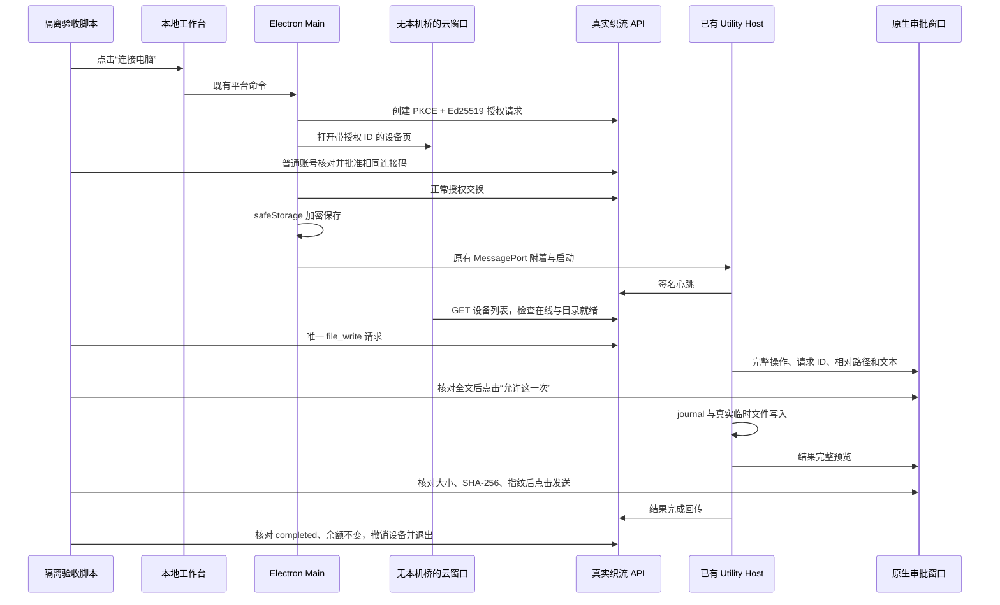

# 真实 Electron Host 进程验收

验收日期：2026-10-19。构建版本：3.15.2。脚本：`packages/desktop/scripts/zhiliu-host-process-smoke.mjs`。

## 验收方式

Playwright `_electron.launch` 启动当前 `packages/desktop` 开发构建，连接已部署的真实织流 API。没有修改业务源码、发布包 fuse、模型配置或现有用户资料。

测试使用随机新建的普通账号、独立 Electron profile、脚本专属 `mkdtemp` 工作目录。每个账号不充值、不发聊天请求、不调用模型。测试结束撤销本次设备、退出测试登录、关闭本次 Electron 并删除临时目录。服务端保留正常的测试账号与已撤销设备审计记录；未调用数据库清理或删除现有数据。



## 已通过的范围

| 检查 | 结果 |
| --- | --- |
| 服务 API 与 Worker readiness | ready |
| 测试用户 | 新建非管理员，无充值 |
| 启动与安全存储 | 开发态 Electron，真实系统加密存储可用，拒绝 basic_text |
| 用户连接入口 | 真实点击可见“连接电脑”按钮 |
| 账号配对 | Main 正常发起，REST 核对同一连接码批准，正常交换授权 |
| 本地授权持久化 | 独立 profile 内存在唯一非空 `.sealed` 文件；不输出或解密凭据 |
| Host 进程边界 | 连接前后为同一个已有 `zcode-host` Utility PID，未另建 Agent |
| 网页可见设备 | 在真实云窗口执行带测试账号授权的 GET，返回 paired_host、online、workspace_ready 与 file_write 能力 |
| 云页面安全边界 | `window.zcode`、`window.desktop`、`window.require` 均不可用 |
| 原生操作审批 | 使用真实 BrowserWindow，核对请求 ID、授权目录名、相对路径和完整内容，点击且仅点击一次允许 |
| 执行时序 | 审批之前目录为空；审批后本机文件与精确预期内容一致 |
| 原生结果审批 | 核对相对路径、字节数、SHA-256、fingerprint 和字段数量，正常点击发送完整内容 |
| 原生窗口安全配置 | sandbox、contextIsolation 开启，Node 与 preload 不可用 |
| 服务端收口 | 同一工具请求 completed，回传 SHA-256 一致 |
| 计费边界 | 测试前后 balance、reserved 均不变，无模型请求 |
| 清理 | 撤销本次设备、logout、关闭自启客户端、删除自建临时目录 |

## 真实执行记录

第一次运行在粗粒度 `connect-ui` 阶段失败，3 项前置检查通过，尚无操作或结果审批；清理成功。原始异常未输出，避免泄漏设备授权或认证参数。因此该次原因未确认，不能归因为已证实的应用缺陷。

只在测试脚本细分固定阶段并加入整数/布尔诊断后，第二次运行完整通过，未改变生产业务代码：

```json
{"passed":true,"checks":10,"operationReviews":1,"resultReviews":1,"failedStage":null,"cleanupFailed":false,"diagnostics":null,"nativePickerManuallyTested":false}
```

针对首轮未确认的启动阶段失败，以相同脚本和构建再执行第三次；结果再次完整通过，summary 与第二次相同。两个成功回合分别使用独立账号、设备、profile 与临时文件，均完成撤销和清理。这提供连续两次通过的证据，首轮具体原因仍未确认。

## 未覆盖与不能据此宣称的能力

- `app.evaluate` 只在开发态临时替换系统消息框与目录选择器；目录返回值固定为该脚本专属临时目录。原生文件操作与结果审批窗口没有 mock，使用真实页面链接和 Main 导航处理。
- 没有人工操作系统目录选择器；不能将本次结果写为原生 picker 人工验收通过。
- 网页在线检测使用真实云窗口中的 GET；账号批准使用 REST。没有覆盖真实用户在设备页登录、按按钮批准的完整 UI 路径。
- 本次覆盖开发构建的真实 Utility Host 进程链路；不能替代安装包验收，也没有开启发布包 Main Inspector。
- 本次没有调用付费模型，因此不证明自然语言聊天模型会主动选择文件工具、云 Agent 等待后恢复推理或 token 计费正确。对应 API/runtime 测试仍需独立验收。
- 不覆盖本地独立 Agent、Shell、鼠标键盘、整机控制、移动端远控和完整本地会话同步。
- 文件工具为授权目录路径守卫；Electron 审批页面为页面沙箱。两者均不能等同操作系统级工具执行沙箱。当前 ZCode CUA 基线仍是占位，具体依据见 `sandbox-and-control-audit.md`。

## 复现

先完成织流 Main、Host、renderer 的开发构建，并保证脚本固定的本机转发端口可访问真实服务，再在仓库根执行：

```powershell
node packages/desktop/scripts/zhiliu-host-process-smoke.mjs
```

脚本仅输出固定 summary 字段；失败只保留预定义阶段、计数和布尔诊断，不输出原始异常、密码、Token、连接码或原始 API 响应。
