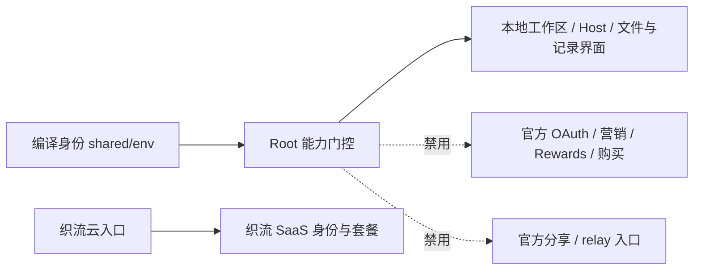
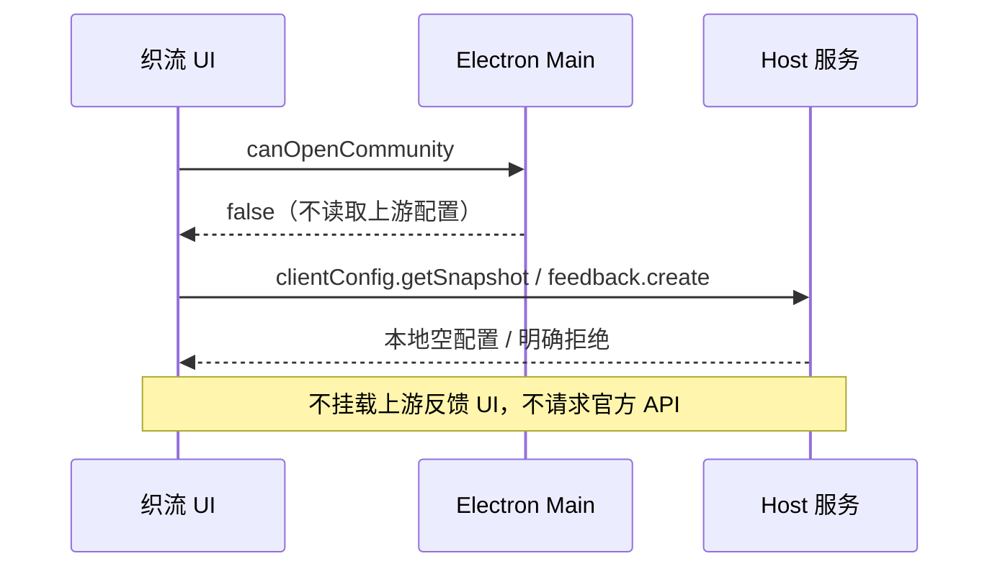

# 织流桌面：上游官方云功能隔离

## 范围与事实来源

本 fork 保留 ZCode 的 Host 分层和本地项目壳。织流用户只通过平台授权使用模型；本批本地推理未接平台网关，不启动 bundled CLI，也不开放个人模型配置。织流构建使用编译期 `__ZHILIU_DESKTOP_ENABLED__=true`；未注入时保持上游行为。`__ZHILIU_CLOUD_URL__` 仅提供织流入口的构建默认值，不是 OAuth、模型或 relay 的隐式替换地址。

上游 `Root.tsx` 原先无条件挂载 OAuth 恢复、Coding Plan 商品查询、Rewards 和营销；上游远控需要官方 relay，分享会将用户内容发布至上游服务。织流自己的账号、套餐和设备权限未接入这些服务前，禁止将其显示为可用的织流能力。

## 状态与责任

- `shared/env.ts` 是构建身份的唯一来源；各层只读取，不在 UI 重新维护品牌开关。
- Root 负责不挂载上游营销与购买流程、不启动官方 OAuth 恢复/轮询/回调，不因缺少官方账号阻止本地工作区启动。
- 禁用的 Coding Plan Provider 保留既有 context 形状，返回空目录和拒绝打开，且不运行商品/权益查询 hook。
- Rewards 与营销禁用分支不挂载其有副作用的实现。
- `useOAuth` 在织流构建拒绝启动上游授权，也不枚举 OAuth 提供商。平台 `notifyRendererReady` 仍执行，以保留其他主进程事件的握手。
- 会话分享按钮和上游分享 deep link 导入关闭；官方远控 feature 在 Root 被强制关闭。自有设备通道需独立接入织流鉴权后才开放。
- 本地工作区和 Host 保留现有分层，个人模型/Key/端点配置、导入和探测关闭；本地推理和依赖 CLI 的能力展示平台授权开放条件。现有会话 owner 和工具权限机制保留在上游代码，不能写成本批已验收的可执行能力。
- 云入口在命令等待期间禁用按钮，避免重复派发。Main 已处理的打开失败会返回 `{ opened: false }`；UI 仍须显示可重试状态。命令成功或再次尝试时清除旧提示，不将“命令已返回”视为“窗口已打开”。

Host/service 增加同一编译身份下的能力边界：OAuth 不读取/恢复官方凭据、不启动/刷新官方会话；官方套餐服务返回空目录与 disabled 功能快照，购买和支付返回 `zhiliu_official_cloud_disabled`；Account Provider Connection Resolver 将上游账号 provider 标为 unavailable，不读取账号身份和权益；Builtin remote release 不下载官方动态配置。Usage Service 保留本地 Agent 数据库用量读取，官方权益返回 not_configured，官方用量监控与配额变更拒绝执行。

禁用不删除旧凭据或修改磁盘上的用户模型；织流构建不读取个人模型配置、不开放个人写入或连接探测，bundled CLI 启动也被拒绝。上游构建的 `api-key` 和静态模板行为保持原样。云 Agent 模型由 SaaS 配置，不以客户端替换域名的方式接管模型。

这是产品入口和服务流程隔离，不是操作系统级网络沙箱。反馈/更新/插件来源等其他上游调用继续由各自边界核查；不能仅凭按钮隐藏宣称“没有任何上游网络连接”。

### 帮助和反馈旁路补齐

织流帮助菜单隐藏上游文档、社区、问题上报、建议、漏洞提交与更新，保留本地资源管理、日志导出和关于。需要问题反馈时用户进入云工作台使用现有 SaaS 能力；此批不新建另一反馈系统，也不将云窗口入口标为已接入的反馈表单。

上游 FeedbackCenter 不在织流构建挂载，包括其工单查询、自动上传和后台指示器。Main 的 `CanOpenCommunity` 在解析远端配置前返回 false，避免工作区启动和 Quick Pick 的可用性查询绕过命令门控。Host client-config 与反馈远端请求的防线见 `official-feedback-config-boundary.md`。云附件沿用 SaaS，本地日志导出保留。

## 验收

1. 织流构建首次启动不弹出 ZCode 官方登录页；没有官方账号也能打开本地项目与设置。
2. 禁用购买 Provider 时不调用商品目录 hook；打开操作返回 false，子组件继续可读取 context。
3. 禁用 Rewards/营销时不挂载 WebView、轮询器或其服务 hook。
4. 织流构建 `useOAuth` 不调用 getProviders/startOAuthWithPolling，不打开官方授权 URL。
5. 织流构建不显示分享按钮、不接纳上游分享导入 deep link；远控 feature 无法由启动 props 覆盖为 true。
6. 未注入织流编译标记的上游构建保留原行为；已有 OAuth/购买/分享回归继续通过。
7. 执行类型检查、lint、架构检查和受影响测试；分别记录代码问题与依赖或运行时环境的限制。
8. 直接调用 Host 官方账号/套餐/权益 API 也不能绕过 UI 门控；依赖 spies 证明没有 credential / apiClient / availability / remote-download 调用。用户 BYOK、本地 CLI 和平台网关分别由托管模型边界限制；关闭官方服务不能单独证明这些边界。
9. 云入口收到 `{ opened: false }` 或命令抛错后，按钮恢复可点击并展示重试提示；重试成功清除提示。等待结果期间重复点击不能再次派发命令。
10. 织流帮助中不出现上游文档/社区/反馈/建议/漏洞/更新，保留资源管理、导出日志和关于；不挂载 FeedbackCenter。工作区启动查询 `CanOpenCommunity` 返回 false，且不调用远端配置读取器。上游构建菜单和反馈行为保持原样。
