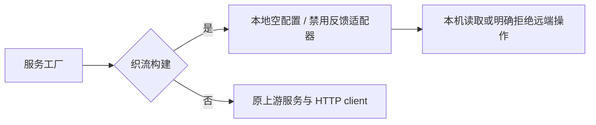

# 织流官方反馈与公开配置边界

## 产品规则与所有者

`ZHILIU_DESKTOP_ENABLED` 是构建身份，由共享编译配置提供。织流构建不复用 ZCode 官方反馈工单及公开客户端配置服务；未开启该标记的上游构建保持原有行为。

- `IClientConfigService` 仍为公开配置快照的唯一入口。织流 `getSnapshot` 校验原读取参数，直接返回共享协议认可的空快照 `{ pluginStoreOrder: null, zsrcUrl: null }`，不解析上游端点、不调用请求上下文、不读取网络或凭据。每次返回独立快照，强制刷新也不访问上游。
- `IFeedbackService` 仍为反馈操作的唯一入口。织流在构造官方 HTTP client、工单缓存或读取旧凭据之前进入禁用分支。创建、列表、详情、评论及所有附件和日志上传均以 `OfficialCloudDisabledError` 拒绝，稳定错误码为 `zhiliu_official_cloud_disabled`。
- 本地取消是幂等空操作；订阅上传进度只创建本地 emitter，不发出伪造的上传成功事件。设备快照、用户显式触发的本地日志导出/展示/清理仍在本机执行，不会自动上传，不读取官方账户。
- 该适配器只负责官方反馈与公开配置。个人模型配置与本地执行由独立托管模型边界封闭，织流云端入口仍使用 SaaS。本约束不是操作系统网络沙箱，也不宣称封锁全部上游地址。

## 执行顺序

禁用分支不保存远端队列或工单事实，不开始 HTTP 请求，也没有待恢复的远端副作用。取消不改变既有官方凭据或本地历史工单。

## 验收

1. 织流读取配置与强制刷新均返回合法空快照，结果互不共享可变状态；上下文解析器与网络 mock 均未调用。
2. 织流所有远端反馈入口均返回统一禁用错误；工厂不创建 HTTP client、不读取凭据/OAuth/设备身份、不创建工单存储，也不导出或暂存待上传附件。
3. 取消创建、取消上传及进度订阅/退订无需联网；本地设备快照可用，本地日志导出与清理保持原接口。
4. 未启用织流标记的现有公开配置与反馈回归测试继续通过。
