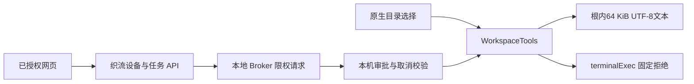

# ZCode 本地控制与沙箱核查

核查日期：2026-10-19。依据本地源码；上游固定基线为 `6d5982eb94c8f12a6a8c8b778da1a9f447208a5a`。本文区分已有上游实现、织流接入与仍然缺少的执行能力，不将类型、界面或私有构建功能当作开源交付。

## 结论

ZCode 的 Host、任务控制、审批和跨端恢复可以复用。当前开源树不包含完整 Computer Use producer；CLI 命令执行没有操作系统沙箱。织流首版只开放原生选择目录后的受控文本文件读写，命令执行固定拒绝。

| 能力                    | 源码事实                                                               | 接入决策                                                               |
| ----------------------- | ---------------------------------------------------------------------- | ---------------------------------------------------------------------- |
| 浏览器/手机控制桌面会话 | 存在配对、transport、共享 Host attachment、v4 命令和重连恢复代码       | 复用层次和状态所有者，改为织流认证和设备 scope；不直接开放上游全部 RPC |
| 追加、停止、审批        | `sendText`、`stop`、`resolveInteraction` 进入同一会话运行时            | 不能为 Web 另起第二套 Agent；保留 owner/lease 与失效结果检查           |
| 工具审批                | allow/ask/deny、风险和副作用声明、异步审批和取消                       | 复用审批语义；平台硬性授权不能依赖可跳过普通审批的模式                 |
| 本地 Shell 隔离         | 普通 Node spawn；`ExecutionRequest.sandbox` 未被当前 exec adapter 执行 | 不开放 terminal；后续使用真实 OS 隔离执行器                            |
| 插件/生成 HTML 隔离     | Electron guest sandbox、无 Node、CSP、owner 和资源撤销                 | 继续复用，但不能称为命令沙箱                                           |
| Computer Use            | `@zcode/zcode-cua` 是不可用占位包                                      | 保持关闭；另行接入并验收真实 producer                                  |

## 源码依据

- `packages/zcode-cua/package.json`：`zcodeCuaPlaceholder: true`，描述明确是 API-compatible placeholder。
- `packages/zcode-cua/index.js`：`createComputerUseRuntime().execute()` 返回 unavailable 和 `isError: true`。
- `packages/zcode-cua/broker-server.js`：启动、健康、授权等 runtime surfaces 抛出不可用错误。
- `packages/desktop/scripts/computer-use-producer.mjs`：明确区分私有真实 producer 与开源占位包，后者不构建或打包真实 Helper。
- `apps/zcode-cli/packages/adapters/src/exec/node-execution-adapter-run.ts`：`spawn` 是实际执行点；旧 protected-resource sandbox 已撤除的注释仍在。
- `apps/zcode-cli/packages/adapters/src/exec/node-execution-adapter-process.ts`：只构造普通 cwd、env、shell、stdio 与进程树终止参数，没有容器、AppContainer、Seatbelt 等隔离。
- `apps/zcode-cli/packages/contracts/src/interfaces/execution.port.ts`：保留 sandbox policy 字段，但 exec 目录没有消费 `request.sandbox` 的实现。Bash 的 `sandboxed` 输出不能作为实际隔离依据。
- `apps/zcode-cli/packages/core/src/tool/handlers/bash-cwd-policy.ts`：命令成功后重置越界 cwd；它不能阻止该次命令访问外部文件。
- `apps/zcode-cli/packages/core/src/permission/service.ts`：`yolo` / `guarded` 普通调用走 allow；`alwaysAsk` 等特定闸门另行处理；`auto` 仍未实现。平台硬 deny 必须位于独立不可绕过的授权层。
- `apps/zcode-cli/packages/core/src/tool/executor/permission-request.ts`：先登记再发布审批，绑定 AbortSignal，避免已取消请求再次发布。
- `packages/services/src/zcode-agent/zcodeTaskServiceAdapter.ts`：审批回执收敛 `resolveInteraction`；追加与停止同样使用 v4 会话命令。
- `packages/desktop/src/main/webRemoteControlSharedHostAttachments.ts`：附着现有窗口 Host，使用 `web-remote-replayable`，不为手机创建独立运行时。
- `packages/desktop/src/main/webRemoteControlManager.ts`：转发与 attachment 调度，不持有第二份任务事实；raw adapter 拥有 replay buffer。
- `packages/desktop/src/main/index.ts`：此前技术版通过织流 feature gate 关闭上游 relay；不能把改品牌视为账号/远控已接通。
- `packages/services/src/zcode-agent/zcodeAgentProcessManager.ts`：此前技术版在 getClient 处阻止织流本地 CLI 启动，避免读取个人 Key/config 或绕过平台计费。
- `packages/desktop/src/main/pluginSandbox/CONTRACT.md`：描述不可信 HTML guest、CSP、权限确认、owner、实例撤销及资源访问边界。
- `packages/desktop/src/main/zhiliuCloudPolicy.ts`：云页面 sandbox/contextIsolation 开启，Node 关闭，不能注入通用桌面 preload。

## 首版受控文件工具

合同见 `specs/zhiliu-workspace-tools.md`，实现为 `packages/desktop/src/host/zhiliuWorkspaceTools.ts`。

该模块不持有平台凭据、不调用模型、不启动 CLI。调用方必须完成设备/空间授权、原生审批、取消收口和 journal。`info` 仅含展示名、`file_read/file_write`、`terminalExec: false` 和 `isolation: workspace-path-guard`，不能将实例私有绝对路径上报云端。

文件检查包括绝对路径/UNC/ADS/穿越/Windows 保留名/敏感路径、UTF-8 与二进制检查、64 KiB 上限、硬链接/目录链接检查、根和父目录身份以及写入前后 fingerprint。临时文件独占创建，新文件使用 no-replace 提交，既有文件使用同目录 rename，同实例写入串行。

## 不可扩大解释的限制

审批是“是否同意这个动作”，路径守卫是“限制本工具的路径”，OS 沙箱是“限制运行进程及其子进程的系统能力”，三者不是同一机制。

Node 没有跨平台原子 compare-and-swap rename。既有文件最后检查与 rename 之间仍可能被同机进程竞争；Windows 没有当前模块可用的目录句柄相对 no-follow API。Node 的 lstat/realpath 能拒绝已识别 symlink/junction 与路径重定向，但不能证明已枚举所有 Windows reparse tag。Linux FD 锚点降低目录替换风险，也不消除最终目标 CAS 竞争。因此本工具不用于对抗同机恶意进程；该威胁模型需要原生 OS 沙箱或独立隔离执行环境。

取消也不能撤销已经完成的文件 rename；调用层必须区分执行前取消、执行中停止和已提交结果，不因网络重试重复工具。断线恢复应消费 journal 中已有结果。

## 接入验收

1. 跨租户、空间、设备请求拒绝；退出或撤销后不接受新请求。
2. 只有原生选择的目录可访问；云端不能传绝对根目录或请求任意 Host RPC。
3. 路径逃逸、敏感文件、链接、二进制和超限访问拒绝；错误不携带本机绝对路径。
4. 审批前读取 fingerprint，审批后比较；同内容换文件、父目录变化、同旧版本并发写入均拒绝覆盖。
5. 本机拒绝、取消、超时不能由远程 yolo/guarded 参数覆盖。
6. requestId/device/workspace/run/generation 与 journal 唯一绑定，断线重试不能重复写入。
7. 平台上游 Key 不下发；平台推理、usage 和积分结算通过前不开放本地 CLI。
8. 插件 HTML 验收与本地执行隔离验收分别记录；Computer Use 未接通时不得出现“可控制电脑”的完成标记。

本报告最初结论来自只读源码核查；受控文件工具的自动化验证单独记录在对应测试文件和本次交付报告中。未做真实 OS 沙箱或 Computer Use 验收。
