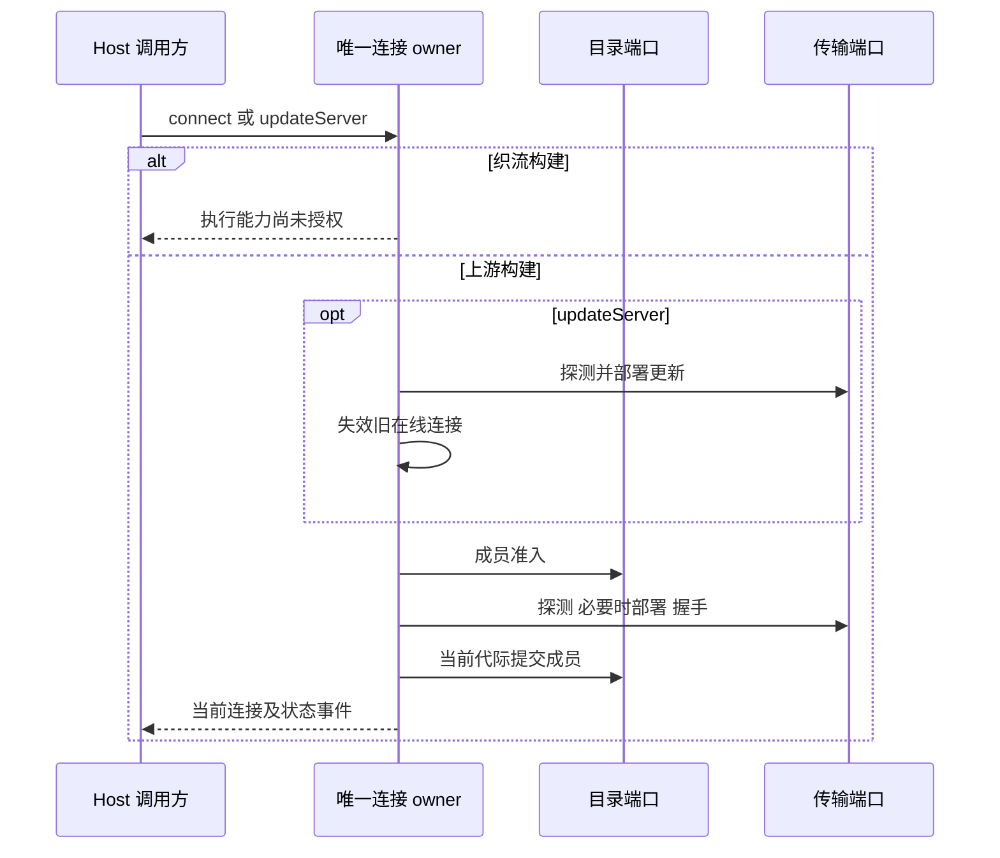

# Host Source Server connection

`SourceServerConnectionManager` 是 Host 内物理连接、连接 flight、重试定时器及连接代际的唯一 owner。本模块仅登记边界并提供原端口的类型视图；实现继续位于上游 `../sourceServerConnectionManager.ts`，既有调用路径和行为不变。

- `SourceServerDirectory` 通过 admission/recordHandshake 端口持有持久成员关系；本模块不保存第二份 Profile、任务、账号或积分事实。
- Transport Adapter 执行探测、部署和握手。等待期间的取消由原 flight identity 和 AbortSignal 约束；旧 flight、移除 Profile 或已断开的连接不能提交迟到结果。
- `connect` 和 `updateServer` 完成握手及成员提交后发布可复用连接；查询和事件读取同一 owner。文件传输仅属于其在线连接代际，不能隐式重连。
- 织流构建在连接/更新的任何 IO 前拒绝，启动自动恢复为空；不能由此启动未授权的远端 Agent。未启用品牌标记时保留上游准入、更新和恢复流程。
- desktop 提供现有目录、日志和 duplex 端口；project-storage 提供稳定的禁用错误；rpc 提供事件；server 提供传输；services 提供服务访问器；shared 提供协议。上述依赖在 module 与 policy 同步声明。

