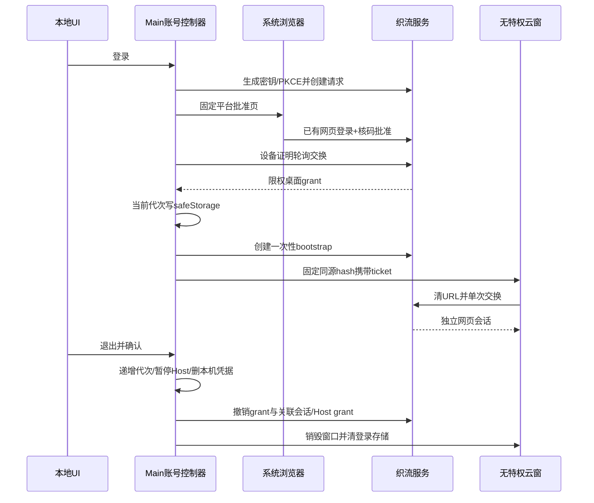

# 织流浏览器授权登录与退出

日期：2026-10-19。实施前契约；不修改上游官方 OAuth 服务。

## 产品规则

- 本地工作台提供「登录织流」「账号状态」「退出登录」。固定平台地址在系统浏览器打开；浏览器已登录时只需核对连接码、账号和空间，未登录时先登录再回批准页。
- Main 是桌面账号凭据和授权代次的唯一所有者，凭据用系统 safeStorage 加密。UI 只获取脱敏身份；远端云窗继续无 preload/Node/本机 RPC。
- PKCE S256、Ed25519 证明、随机 device_code 和一次性交换保护桌面登录；不依赖 `zcode:` 回跳，不读取浏览器 Cookie，不在 URL 放登录 token。
- 登录不选择目录、不启动文件工具。连接电脑仍有独立的 Host grant、目录选择和逐次审批。两者复用本机设备密钥以避免同一账号产生两台重复设备。
- 桌面账号授权独立于批准时的浏览器会话。批准和交换时检查该会话，交换后浏览器退出不影响客户端；客户端退出撤销桌面 grant、所属会话及其云窗会话。
- 云窗免密进入使用短期一次性 bootstrap ticket。Main 的 login_token 永不交给 renderer；ticket 通过固定同源 hash 路由交给云窗，立即移除 URL 参数后交换独立网页会话。ticket 60 秒有效、一次消费且仍检查 grant/成员/设备。
- 重复 bootstrap 先清当前云窗本地身份，不调用整账号退出接口。被新请求取代的子会话结果只丢弃；同 grant 其它云窗不得因一次迟到结果被撤销。旧子会话随 grant 撤销或自然过期，显式退出才撤销整份桌面授权。
- 连接电脑时，已有云窗复用其关联登录并进入文件授权页；不存在云窗才使用 bootstrap。避免为站内功能跳转重复接入登录页，导致 hash 路由替换取消正在进行的 Electron 导航。
- 点击退出先显示确认：「退出后，网页将无法控制这台电脑执行任务。当前电脑连接会断开，本机待确认操作会取消。云端任务可能继续运行。」默认取消。确认后先暂停本机连接和审批、清除 Host 凭据，再撤销账号并清除云窗登录数据。
- 离线时也必须完成本机退出；若服务端撤销未确认，明确提示可在网页撤销设备，不能声称已完成远端撤销。重启不得从旧凭据恢复执行。
- 退出/取消之后迟到的授权、保存和 bootstrap 不得恢复账号；迟到 grant 尽力撤销。重复登录聚焦同一授权，不并行发起；超时可以重新登录。
- 服务端判定当前桌面授权失效时，Main 同步使旧代次失效并发布覆盖整次本机清理的屏障，再依次暂停文件桥、断开并删除 Host 凭据、删除账号凭据、关闭并清理云窗。新登录必须等待该屏障成功结束，之后才能创建设备授权、保存新凭据或打开新云窗；不能只串行单次磁盘读写。等待期间取消仍使本次登录失效，旧清理不应取消后续明确发起的新登录。清理失败时保持拒绝新登录，不能让旧清理继续删除新账号的数据。
- 本批不开放本地模型、CLI、Skill/MCP 或任意终端，既有平台计费链不变。

## 服务端契约

所有端点位于 `/api/desktop-auth`。使用现有 User、Space、AuthSession、RegisteredDevice，新增授权/登录 grant/单次 bootstrap 记录；AuthSession 增加可空 `desktop_login_grant_id`。native grant 关联独立 AuthSession，用 opaque `login_token` 仅访问以下窄接口，不接受它访问普通业务 API。

| 路径 | 行为 |
|---|---|
| POST /authorizations | `{name,platform,public_key,code_challenge}` → `{authorization_id,device_code,user_code,expires_at,poll_interval_seconds,verification_path}`，10 分钟有效 |
| GET /authorizations/{id} | 正常网页 Bearer 预览客户端、核对码、状态；不暴露 device_code/PKCE |
| POST /authorizations/{id}/approve | 网页 Bearer + `{user_code}`，批准当前账号/空间；批准不同身份冲突 |
| POST /exchange | `{authorization_id,device_code,code_verifier,signature}`；签名原文 `zhiliu-login-exchange\n{id}\n{device_code}\n{verifier}`。pending 为 409 `authorization_pending`；成功返回 `{login_token,device_id,user_id,space_id,expires_at,user,space}` |
| GET /session | `Bearer dl_...`，实时校验登录、成员和设备，返回身份/期限，不含上游信息 |
| POST /bootstrap | 同上，返回 `{ticket,expires_at}`，绑定该 grant，60 秒 |
| POST /bootstrap/exchange | `{ticket}`，一次性消费，签发关联 grant 的独立标准 SaaS TokenResponse；Cache-Control: no-store |
| POST /logout | `Bearer dl_...`，幂等撤销 grant/root session/关联网页会话，并撤销同设备 Host grant、清空设备在线与目录就绪状态 |

授权预览与批准页 `/#/desktop-authorize?authorize={uuid}`；云窗接入页 `/#/desktop-session?ticket={opaque}`。普通网页登录密码/注册流程保持兼容，并严格保留批准页站内路由。

RegisteredDevice 使用相同用户/空间/公钥查找；跨账号、跨空间或已撤销设备密钥拒绝，重新登录使用新密钥。不得把账号登录当作文件连接的在线心跳。

## 所有者和顺序

## 验收

1. 浏览器已登录与未登录两条链；客户端不呈现密码或模型Key输入。
2. 错误PKCE/签名/核对码、过期、同code并发交换只允许一次成功，跨用户/空间隔离。
3. Native token不能访问业务API；bootstrap单次消费且无效grant/设备/成员拒绝；网页refresh也实时受grant撤销约束。
4. 登录后电脑仍离线、无授权目录；独立目录授权后仍逐次审批。
5. 取消退出不改变会话；确认退出停止Host、清safeStorage、清云窗登录，重启不复活。断网退出有明确结果。
6. 取消/退出与迟到exchange、保存、bootstrap及多窗并发不会复活旧账号。
7. 真实Electron进程验证浏览器启动、免密云窗及退出提示；SaaS PostgreSQL隔离测试、既有文件桥与账号回归；桌面typecheck/lint/架构检查。
