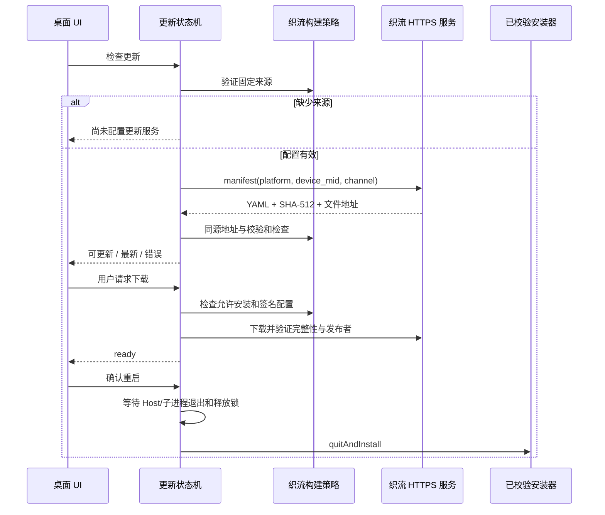

# 织流独立桌面更新

## 产品与配置规则

- 织流使用自己的更新清单，不复用上游更新服务、运行时 Endpoint、环境变量 feed 或 CLI feed 覆盖入口。
- 唯一来源是打包时注入的 `ZHILIU_UPDATE_MANIFEST_URL`。未配置则关闭检查、下载和安装，手动检查明确说明「尚未配置织流更新服务」。不提供用户编辑更新源的界面。
- 清单入口必须为 HTTPS，无用户凭据、查询参数、fragment、反斜杠或控制字符，并拒绝已知上游 `z.ai` 域。平台、设备和 stable/preview 通道参数由既有 manifest provider 按原协议添加。
- 清单内文件和可选 package 的地址必须为同源 HTTPS，且有 SHA-512 校验和。构建方通过同域路径分发安装包及 blockmap；不接受清单指定第三方下载源。
- 默认技术包仅可检查；`ZHILIU_UPDATE_INSTALL_ENABLED=1` 才开放下载和安装。Windows 还必须设置 `ZHILIU_UPDATE_PUBLISHER_NAME`，并在运行时校验 `app-update.yml` 的固定发布者，避免依赖库在发布者缺失时跳过签名检查。
- Windows 正式安装更新复用 electron-updater Authenticode 发布者校验；macOS 正式分发必须签名、公证并验证 Squirrel 更新。SHA-512 只验证文件完整性，不能替代发布者签名。
- 织流未配置时打包 `publish: null`，已配置时写自己的 generic 源及固定发布者。上游构建保持既有配置。
- 仅织流的发布包元数据 `name` 使用 `zhiliu-desktop`，生成独立 `zhiliu-desktop-updater` 缓存；不更改 monorepo 包名和内部协议。

## 所有者与时序

- `zhiliuUpdatePolicy.ts` 是配置、下载地址与校验和约束的唯一纯规则入口；构建脚本和 Main 复用它。
- Main 原有 `autoUpdater.ts` 继续拥有更新状态、检查 generation、通道、下载取消、安装准备及错误恢复；不新建平行状态机。
- `ManifestUpdateProvider` 继续解析服务端 YAML；织流模式要求明确来源并限制文件地址，普通上游模式保持原行为。
- UI 只显示 Main 事件和提交检查/下载/取消指令；不拥有来源和安装裁决。
- 织流标题菜单和帮助菜单始终显示自有检查入口，不能被上游 Preview 身份隐藏；是否能检查或安装由 Main 的自有策略裁决。

## 失败与回滚

- 配置非法、清单缺校验和、跨源文件、签名失败或退出准备失败均拒绝安装，保留当前版本；检查/下载失败复用原状态机的错误事件和重试入口。
- 技术版不得通过恢复旧 ready 记录、后台强更入口或已有自动下载偏好绕过检查模式。
- 下载失败可回到可更新状态。安装后的崩溃自动回滚尚未实现；正式发布保留上一签名安装包，问题版本撤回清单后以更高 SemVer 发布修复/回退内容，不启用任意降级。
- 不宣称已验证真实签名安装更新，直至完成自己的 HTTPS 服务、签名包与平台安装验收。

## 验收场景

1. 缺少来源及非法 URL 均不发网络请求；上游 feed 环境变量和命令行不能覆盖织流来源。
2. 合法来源仅请求织流 manifest，stable/preview 保持原参数协议；缺失来源不可创建默认官方 provider。
3. 文件相对路径可解析；HTTP、跨源、凭据、query/fragment、缺失或格式不合法的 SHA-512 均拒绝。
4. 技术版检查模式即便已有自动下载偏好、ready 缓存或用户下载指令也不下载和安装。
5. Windows 开放安装前固定 publisherName 与安装包配置匹配；缺失/不匹配时关闭安装。
6. 普通上游构建原有 provider 和更新状态回归通过。
