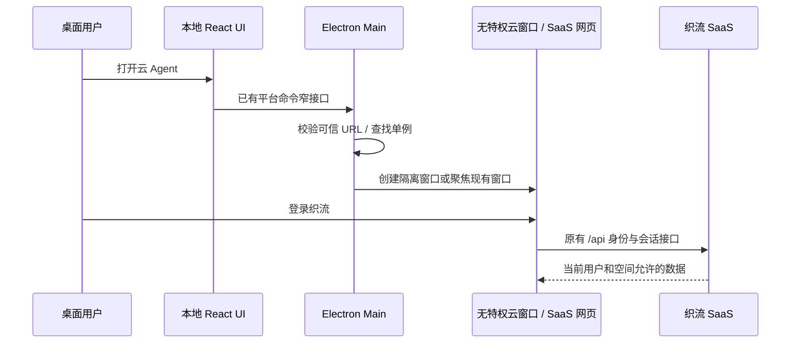

# 织流云 Agent 独立窗口

## 本批行为

桌面提供独立的「云 Agent」入口。本地项目继续由现有 React / Host 管理；云 Agent 直接使用织流现有 SaaS 网页，复用登录、空间、会话、附件、积分与服务端权限。两类会话的权威数据不合并，打开云窗口不自动上传本地历史或目录。

Main 是云窗口唯一所有者，可信启动配置提供 `ZHILIU_CLOUD_URL`，renderer 只提交打开命令。相同 origin 重复打开只恢复、聚焦已有窗口，保留登录与草稿；换 origin 时关闭旧窗口，并使用不同的浏览器 partition。Main 不接收或记录网页中的登录 Token。

## 安全和生命周期

- URL 必须是 HTTPS；开发和 SSH 隧道仅允许 HTTP loopback（localhost、127.0.0.1、[::1]）。拒绝 credentials、query、控制字符和非 Web scheme，允许 hash 路由。地址只来自可信 Main 配置，不能由网页指定。
- 独立 origin 派生的 `persist:zhiliu-cloud-*` partition；无 preload、无 Node、开启 sandbox / contextIsolation / webSecurity；不提供 `window.zcode` 或通用 IPC，不使用主 renderer 的 partition。
- 顶层导航及重定向只允许固定 origin；子 frame 额外允许相同 origin 的 blob 预览。所有 popup 和嵌套 webview 默认拒绝；不自动调用系统 shell 打开页面指定的 URL。
- 拒绝摄像头、麦克风、剪贴板特权、通知、设备及屏幕捕获等 Web 权限。附件文件选择仍由 Chromium 的用户文件选择框完成；音乐/视频生成属于服务端功能，不需要系统采集权限。
- 下载仅接受云窗口自身发起的同 origin / 同 origin blob 下载；使用系统「另存为」对话框，由用户选择文件位置，永不自动打开文件。
- 加载失败关闭新窗口并向调用者抛出错误，由入口展示故障；不把 URL 中的 query/hash 或用户内容写入日志。页面不能覆盖系统标题。
- 关闭窗口释放监听器和窗口引用。当前 SaaS Token 存在 sessionStorage，关闭窗口后重新打开需要重新登录；本批不把 Token 复制进桌面凭据库。

## 边界

本批云窗口不提供设备工具桥接或本地远控。云网页继续使用原有服务端鉴权、租户与积分规则；本地项目不会自动取得 SaaS 身份或平台模型 Key。后续设备连接必须通过独立限权 adapter，并沿用本机确认、设备撤销、space / owner 绑定和工具 journal。

### 统一授权与模型管理

织流用户只登录平台、使用平台授权，模型与上游 Key 由平台管理员维护。桌面不提供个人 API Key、模型供应商、端点、模型目录编辑、连通性测试或供应商导入入口；旧设置导航和直接挂载组件也不得恢复这些界面。上游构建不受此规则影响。

本地推理网关尚未上线，本批不启动 bundled CLI，包括只读 lane，防止从项目、HOME 或环境变量恢复旧模型来源。本地对话输入和上游模型选择保持关闭，并提供「登录云 Agent」操作；该操作仅打开上述隔离云窗口，不代表本地 Host 已获得平台授权。云端模型范围与积分仍由 SaaS 决定。桌面保留项目打开、文件、Git 和应用内已有记录的查看；依赖 CLI 的 Skill/MCP、子 Agent、命令与自动化管理本批不可用，对应入口显示开放条件说明，不能将其写成已验收可执行能力。

首启不挂载上游职业/供应商引导；云入口在首次打开时即可使用。界面不再出现「使用自有模型服务」或让用户填写 Key 的提示。只有完成设备授权、网关计费和本地推理验收后，才可以开放桌面本地模型执行。

上游 OAuth、Coding Plan、Rewards、分享、relay、配置 CDN、模型服务、遥测和更新不能因为换了品牌就视为织流已接入。品牌构建应隔离官方入口，关闭未配置的 telemetry / auto-update；Main 的全局遥测注入也不得对云窗口启用。本窗口不调用上游端点、不加载上游专用 preload。

## 验收

1. HTTPS 和 loopback 隧道能打开；非 loopback HTTP、file、javascript、credentials、query 被拒绝。
2. 两次打开同 origin 不重载、不重复窗口；最小化后恢复；切环境不复用登录 partition。
3. 远端页面无 Node / zcode / desktop 桥，不能弹窗、跨 origin 导航、开启 webview 或取得系统权限。
4. 同 origin hash 路由和 blob 附件预览可用，下载需要用户选择位置。
5. SaaS 原有登录、空间过滤、聊天历史和计费由现有 Web/API 验证；不另外复制状态机。
6. 首次加载失败可重试，关闭后无悬挂下载监听器；错误日志不含凭据和 URL 参数。
7. 织流构建不能从设置、旧导航、登录页或聊天模型菜单进入个人模型/Key 配置；本地输入不产生发送或模型连接请求，登录云 Agent 可打开隔离云窗口。未开启织流标记的上游行为保持原样。

自动化验证：Node 24 下运行 `pnpm exec vitest run packages/desktop/test/zhiliuCloudPolicy.test.ts packages/desktop/test/zhiliuCloudWindow.test.ts`；真实 Electron 验证运行 `node packages/desktop/scripts/zhiliu-cloud-window-smoke.mjs`。后者使用本机临时 HTTP fixture 和独立临时 profile，不连接外网，也不接触现有用户会话；下载检查会在弹出保存对话框之前取消测试文件。
