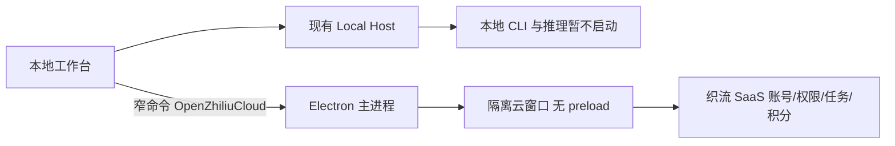

# 织流桌面技术版

## 本次交付与边界

以 ZCode `6d5982e` 为基线，在独立 fork 分支开发。保留 Apache-2.0 许可、NOTICE 与上游 remote。
构建开关 `ZHILIU_DESKTOP=1` 统一决定主进程、Host、Renderer 的品牌功能；未开启时保留上游行为。
产品名「织流」、appId `ai.zhiliu.desktop`，与 ZCode 正式/Preview 的安装和数据目录隔离；不导入旧凭据或会话。
旧织流测试版可能使用相同产品名但不同 appId；本批快捷方式命名「织流 SaaS」，不覆盖旧测试版或原 ZCode 的快捷方式。
当前织流技术版不注册上游 `zcode:` 深链或上游 Explorer/Finder 集成，避免覆盖同机 ZCode 的系统入口；自有深链后续再启用。

- 云 Agent：通过固定可信服务地址打开无特权云窗口，登录、空间、Agent 目录、附件、SSE 和积分继续由 SaaS 拥有。
- 本地项目：保留 window-scoped Host 分层；模型由织流平台统一管理，用户不能配置模型、Key 或上游地址。此批平台推理与计费网关尚未接通，本地推理 fail closed，不允许退回 BYOK；不得下发管理员 Key。
- 本地项目和云 Agent 有明确的持久入口；不把两者的身份、历史或钱包合并成第二份事实。
- 官方 ZCode OAuth、订阅、奖励、分享和手机 relay 不接入织流账号；织流构建关闭这些入口。账号授权仅由织流 SaaS 承担，本地不读取、导入或执行用户自有模型配置。
- 桌面与 Web 相互派发本地任务、四端历史同步、平台本地推理计费网关是后续任务，不能在本版宣称完成。
- 开源 Computer Use producer 是占位能力。本地工具审批不等同于操作系统沙箱。

## 配置与所有者

`ZHILIU_CLOUD_URL` 在构建时固定，主进程可由同名环境变量覆盖；仅接受 HTTPS 或 HTTP loopback，不从 Renderer 接收任意 URL。
默认用户数据根为 `~/.zhiliu-desktop`，内部保留 ZCode 路径布局以减少上游维护差异。
显式 `ZCODE_DATA_BASE_DIR` 仅用于运维/测试隔离，读取本品牌数据根内的设置，不读取原 ZCode 的 bootstrap 设置。
品牌默认根由 services 路径模块统一解析，启动设置和设置服务读写使用同一规则；清空自定义目录回到本品牌默认根。显式数据根和已设置的数据根优先于启动设置文件；未开启织流构建时保留原 ZCode 默认路径和身份。
存储扫描/清理的默认根和全局 CLI 的 Computer Use 配置探测也遵循品牌根；在 Desktop 装配层注入正确根，不改变 Storage 模块的双根合同，不扫描或清理原 ZCode 数据。
Electron profile 使用独立的「织流」目录，云网页使用按 origin 分开的 partition，不能访问本地 RPC/preload。

### 平台托管模型的服务边界

- Host 的 ProviderConfigRuntime 是模型目录的唯一配置装配点。织流构建在此装配空只读配置源，不实例化个人配置的 Node 文件读取器，不触发旧配置迁移、轮询或上游模型目录下载；保留磁盘旧文件原样。
- ProviderSettings RPC 的个人供应商/模型创建、修改、删除、排序、配置解析和连通性测试均明确拒绝，错误码 `zhiliu_managed_models_only`；关闭界面入口不能代替此边界。
- Provider Provisioning Source/Target 不得读取、复制、导入或写入用户模型配置及凭据，均返回同一拒绝错误。
- 未实现平台托管推理网关前，模型执行必须拒绝，错误码 `zhiliu_desktop_inference_unavailable`，不得因为存在旧配置、环境变量 Key 或调用方注入的 readiness 而放行。
- 本批在 ProcessManager 的唯一 getClient 启动入口拒绝所有 lane，包含只读 CLI；CLI 初始化也会读取 HOME/项目/env 配置。文件浏览、Git 和应用内已有记录可继续使用，但依赖 CLI 的历史/Skill/MCP 控制面本批不宣称可用。后续 managed CLI profile 与平台网关一并验收后才能在此边界放行。
- Host 启动只准备自身任务索引，不启动 CLI 的 session storage preparation Worker，也不将未准备的 session 库报告为已迁移。直接调用该 preparation 入口同样拒绝；本地 CLI 尚未开放不应阻塞云窗口或主界面启动。
- 这些规则仅在 `ZHILIU_DESKTOP_ENABLED` 编译标记开启时生效；未开启的上游版本保留原配置、BYOK 与 CLI 行为。

## 验收

1. 同机安装 ZCode 与织流不覆盖，不读取原 ZCode Key/会话。
2. 无需配置本地 Key 即可登录云 Agent，服务地址无效时显示可重试错误。
3. 云窗口不能访问 `window.zcode`、`window.desktop`、Node、任意本地文件或窗口创建。
4. 云窗口中沿用 SaaS 登录/退出、空间权限、附件与积分；云 UI 错误不崩溃本地 Host。
5. 本地项目不展示个人模型配置入口；直接调用 Host RPC 也不能写入或探测自有模型，未接平台推理时不执行本地模型。
6. 同 origin 重复打开聚焦已有窗口，保留草稿；不同 origin 隔离登录态。
7. 未接平台网关前，本地 CLI、模型推理和依赖 CLI 的 Skill/MCP 控制面明确不可用；远控入口在织流接入前关闭。
8. 执行类型、Lint、架构检查、针对性测试与 Electron 真实进程 smoke，安装包记录摘要。
