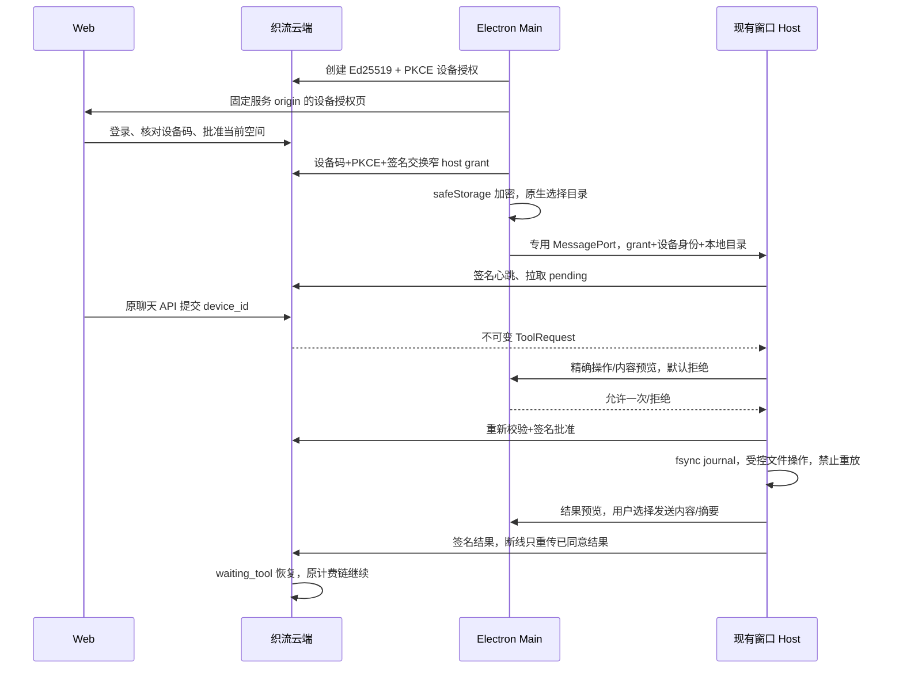

# 织流电脑连接与云端文件任务

本批接通 Web 云 Agent → 已授权电脑 → 本机逐次审批 → 文件结果 → 原云 Agent 续推理。
不启动未接计费网关的 ZCode CLI，不开放 Shell、CUA 或任意 RPC；不宣称完整本地 Agent 或 OS 沙箱。

## 所有者与边界

Main 只拥有原生目录选择、加密凭据、设备配对、受控审批窗口和 MessagePort 调度。
复用一个现有窗口 Host；Host 拥有唯一轮询、目录访问、执行 journal 和待回传结果。
云端仍拥有 Run、ToolRequest、取消、租户权限与计费。云窗口无 preload/Node/本地桥。
Main 每次连接只能附着一个 Host，不创建第二个 Agent/runtime。Host 退出后停止工具连接，重连不重放。

Main 的凭据读取、保存与移除使用同一串行队列。断开先使连接代次失效，再等待已开始的保存完成并移除凭据；晚到的交换或错误不能保存旧凭据、暂停新连接或覆盖新连接状态。网络撤权在本机删除之后执行，不能阻塞下一次凭据读取。

Host 的文件端口只有一个 attachment owner；替换串行等待旧连接停止，连续替换只接纳最新代次。关闭立即禁止新接入，等待中的旧替换必须关闭自己的端口。文件连接清理纳入既有有界 shutdown phase，失败或超时仍继续释放其他服务；整个 Host 不因文件连接清理失败而跳过退出流程。

桌面工作模式栏保留云 Agent、本地项目和问题反馈，并提供可见的“连接电脑”入口。
该入口只通过 UI hook 调用 `IPlatformService.executeDesktopCommand(ConnectZhiliuComputer)`；Main 继续独占授权、目录选择和连接过程。
命令等待期间禁止重复派发，完成回执不代表设备已在线；在线与目录就绪仍以云端设备状态为准。取消或失败后允许重试。

## 时间与恢复

配对 secret 不进入 URL、renderer 或日志。host grant 不能调用普通 API；授权绑定原登录、用户、空间和设备，12小时以内。
每次文件操作前后重新验证服务端请求和 Host generation。暂停/断开/目录变化使旧对话框回答失效。
签名心跳使在线状态60秒过期；本地轮询串行，离线不得执行缓存命令。
每个 request id + nonce + arguments 的摘要先持久 claim；执行前持久 executing。
崩溃或不明确状态只返回失败说明，不能再执行。结果仅在本机明确同意发送后加密保存在 journal outbox；重试相同已签名结果，不能重新跑工具。
请求已取消/过期/撤权时丢弃待发内容并结束；已完成的文件副作用不能谎称回滚。
目录只由系统选择器授权，重启后需重新选择。文件系统路径守卫不是 OS 沙箱。

### 专用工具端口停止规则

`attachZhiliuToolPort` 的单一所有者是既有窗口 Host。端口只允许一次 start；close、stop、重复 start 或无效消息立即先进入 closed，再异步停止连接。closed 后的所有迟到消息必须忽略，不得重新构建连接、发布心跳或创建新审批。

dispose 返回同一个停止 Promise；多个关闭来源不能因 closed 已置位就提前报告停止完成。所有待审批立即以安全拒绝收口；停止后新产生的审批请求也立即拒绝。停止无论成功或抛错都要关闭端口；异步事件入口消费拒绝，显式等待 dispose 的生命周期所有者仍能观察停止失败。无效本地密钥导致的同步构造失败只能关闭该工具端口，不得触发整个 Host 的 uncaughtException。

## 验收

跨用户/空间、撤权、错误PKCE、交换重放、Host token跨scope、失效旧响应全部拒绝。
网页显示真实在线及目录就绪，可选本人的电脑；切身份清选中，不能拿管理员权限操作员工电脑。
本机拒绝则无文件副作用；同请求断线/重启不重复写；已同意的结果可幂等补传。
正常创建/读取UTF-8文件；越目录、链接、密钥文件、绝对路径、Shell/CUA拒绝。
真实服务端与安装客户端完成一次文件任务；模型/Key仍由平台管理，积分由云端真实usage结算。
