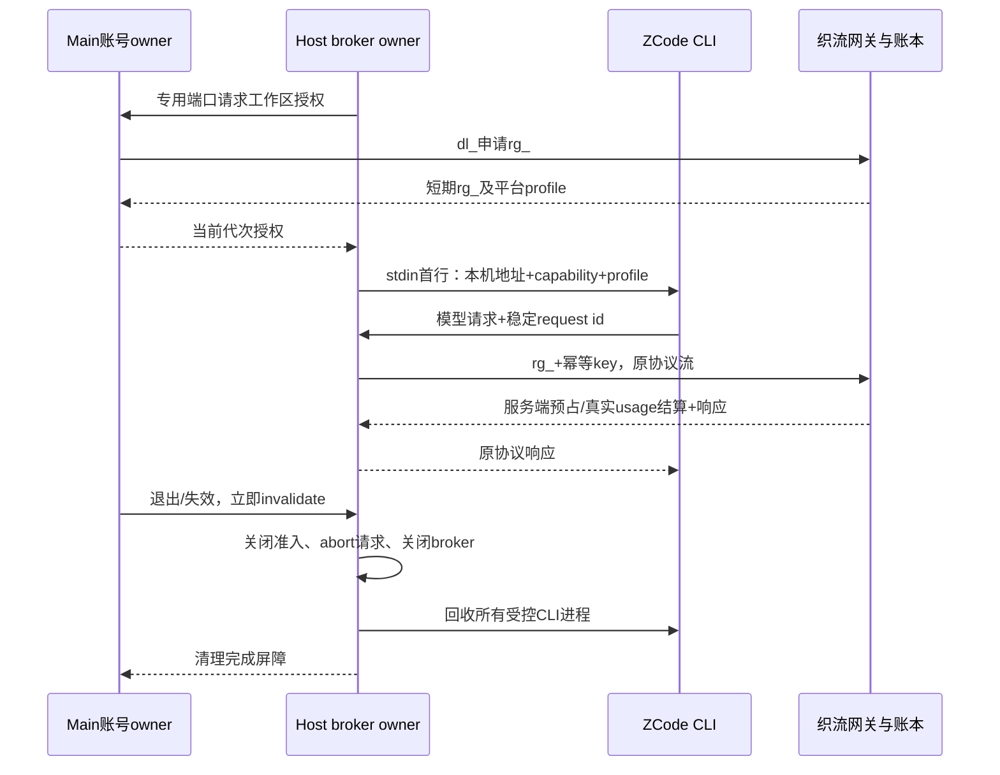
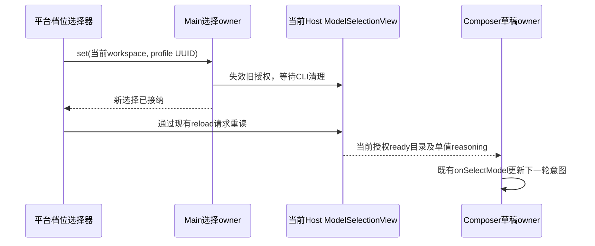
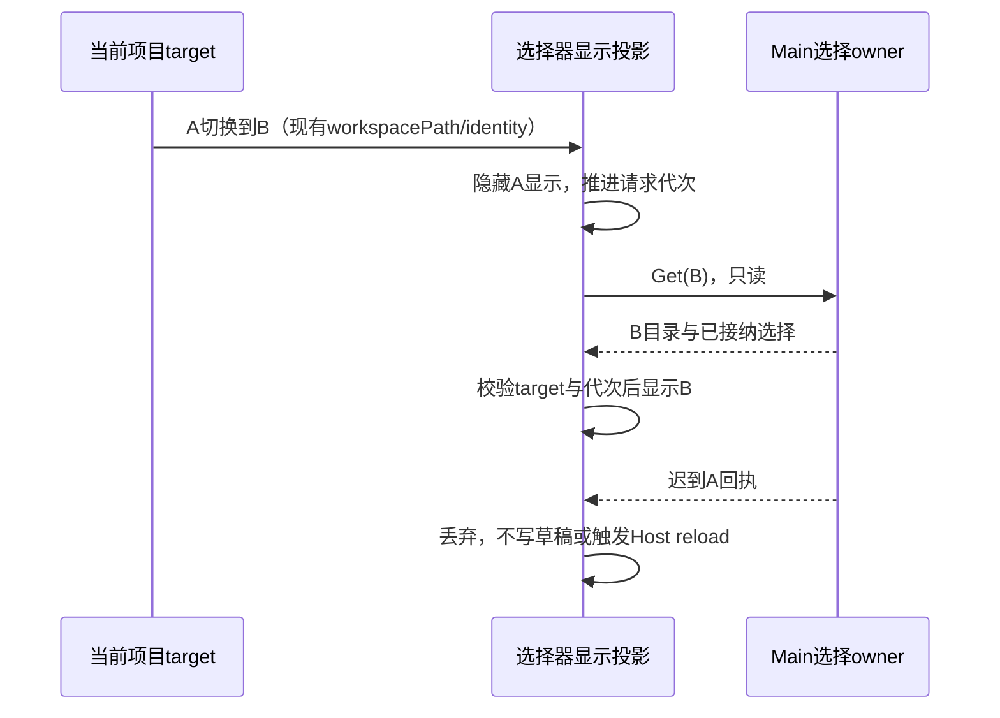
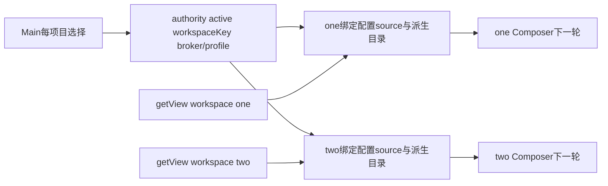

# 织流统一托管运行时

2026-10-21。先于实现定义；保留 ZCode Agent Loop、V4、工具、Skill 和 MCP，不开放个人模型配置。

## 所有者与可信启动

Main 独占系统安全存储中的 dl* 登录授权。Host 通过 Main 专用 MessagePort 请求短期 rg*；Main 每次检查当前账号代次，迟到授权撤销且不下发。rg\_ 只在 Host 内存，禁止写文件、日志、工具环境或 Renderer。Host 以工作区 identity 的 SHA256 为云端标识，不传本机路径。

Host 为每个工作区创建仅监听 127.0.0.1 随机端口的 HTTP broker，随机 capability。CLI 启动参数 `--managed-profile-stdin`，首行是严格校验的 profile；后续原 V4 NDJSON 不变。CLI 仅拿 broker 地址和本机 capability。profile 包含平台模型 alias、协议和上下文/输出上限；不含上游地址、Key、dl* 或 rg*。CLI 禁止从个人、项目和环境变量恢复模型配置，网络策略限定 broker，无重定向。

托管 Host 不装配或订阅官方账号 Provider 同步源；模型目录仅由可信首帧决定，CLI 继续拒绝 `provider/updateAccountConfig` 覆盖。首次登录验收必须等真实 CLI 完成启动和策略同步、Host 标记 model execution ready，再通过原生输入框完成一次模型请求；仅签发 runtime grant 不视为可用。上游异步目录水合可以接手预热，因此不依赖特定一次 `warmup ready` 日志。

原生输入框在织流账号已登录时挂载上游 Composer，保留附件、模式、插件和交互；未登录时显示账号提示。账号操作只向同一窗口广播失效信号，各视图从 Main 重读非秘密投影。Web relay 的原生会话输入不依赖桌面 Renderer 账号 Hook，继续使用已鉴权的 relay 会话。

## 授权与请求合同

`POST /api/desktop-auth/runtime-grants`，dl\_，body `{workspace_identity}`。Main 只接受固定 `/api/runtime-gateway/v1` 和严格 profile；15 分钟 grant 到期前 60 秒续期，single-flight。撤销使用 `DELETE /api/desktop-auth/runtime-grants/{id}`。Model alias 固定 `zhiliu-managed`，protocol 为 responses 或 chat_completions。模型、思考档位、渠道、报价和账本由服务端裁定。

2026-10-21 写记忆版本协商：本版本 Main 的 grant payload 固定增加 `platform_memory_write_capability: "forced_approval_and_execution_identity_v1"`，声明已随同发布的 CLI 具备强制逐次用户审批及稳定 session/turn 执行身份。该值仅由 Main 固定写入，不接受 Renderer、Agent/档位选择或环境配置输入。旧客户端缺失/null 的 grant 必须冻结只读；非法版本拒绝。此字段只做兼容协商，不是远程二进制证明，也不自行开启能力。服务端仍要求 grant snapshot、实时写开关、用户记忆开关和归属校验全部满足；当前写开关保持关闭。

broker 只接受带 capability 的 POST `/v1/responses` 或 `/v1/chat/completions`，且必须匹配平台 protocol。拒绝 Origin、异常 Host、无请求 ID、重定向和超大 body；Authorization 由 broker 换成 rg\_，不转发 Cookie/客户端认证头。每个模型调用以 ZCode 的 x-request-id 作为稳定 Idempotency-Key，重试保持该 key。主任务、子 Agent、标题、压缩均走相同模型 adapter 和 broker；不能信任客户端自报 usage。

## 生命周期与失败

账号退出、授权失效、Host 关闭同步停止新 admission；等待中的 grant/broker 创建受 generation 防护。退出屏障关闭 broker、取消在途并回收所有 chat/plugin/mcp-status CLI，之后允许新登录重新创建，不能永久 dispose services。服务端仍实时检查 grant 根撤销；断网不能使旧凭据重启执行。续期改变协议/限制时不让旧 CLI 静默改配置，要求重建运行时。

未授权或 profile 未就绪保持 fail-closed；服务目录只投影平台 profile。源源码保留本地能力不等同于已接通完整远控；现有文件桥和本批模型 broker 都不是完整 Host relay。

## 原能力入口与UI接线

织流品牌不再隐藏上游插件商店、Skill、MCP、Commands、自动化的设置入口，复用现有组件及其完整生命周期。此处只恢复入口，不新增另一套页面、服务或执行状态。插件和自动化实际调用仍受 Host 授权与统一托管模型准入控制，不能开放模型Key、上游地址或官方OAuth。UI遵循 DESIGN.md、CONTEXT.md 以及织流 UI 交接映射；工作区 identity 优先，保留来源空间、草稿和附件边界。

Host/Main 的专用端口须验证单工作区授权 single-flight、断开时同步关闭broker、迟到授权撤销、清理后重新登录可用。失效清理失败不得返回成功确认；端口关闭要捕获异步清理异常，防止未处理Promise泄漏。

## 验收

- dl*/rg*不进入 CLI 首帧、argv、env、Renderer、工具与日志；只有本机capability。
- 登录前拒绝CLI，登录后真实本地任务、工具/Skill/MCP可执行；没有Key或上游配置入口。
- 两协议、流/非流、子Agent与辅助调用均服务端扣费；重复调用不重复扣费。
- 非loopback/Origin/错误capability/路径/协议/请求ID拒绝，SSE中断传递取消。
- 同工作区并发只开一个broker/续期；退出与迟到创建、多个窗口、重新登录不复活旧身份。
- 根typecheck/lint/架构检查、定向单测与真实CLI网关链通过后开放。

# Desktop 平台目录与工作区选择（2026-10-22）

- Main 使用 native `dl_` 调用 `GET /api/desktop-auth/runtime-catalog`，严格解析 v1 的 Agent/profile UUID、名称和描述；Renderer 不接收真实模型、上游 URL、key、`dl_` 或 `rg_`。
- 通用对话和默认档位分别用 `agent_id=null`、`inference_profile_id=null`，不创建伪 UUID。平台决定套餐、企业分组/Agent 版本和模型路由，客户端目录仅为显示投影。
- 选择归属 `workspaceIdentity?.trim() || workspacePath`，Main 仅内存保存并随账号退出清空；发送服务前转成 `local:<sha256>`。选择更新先失效并等待对应工作区 Host broker/CLI 清理，不影响其他工作区；授权中的迟到响应必须撤销。旧 grant 不得续到新选择。
- 本期 Main 在存在任何进行中的本地任务时拒绝切换；UI同时禁用当前运行任务的选择器。该保守屏障避免同一项目不同标签页的闲置会话意外中断另一个运行任务；后续可在已有任务活动遥测提供可靠工作区粒度后缩小拒绝范围。
- 私有桥的 `invalidate` 可携带可选 workspace identity；未指定仍表示退出时全量撤销。Main 等 Host ack 后才承认新选择，任何清理失败保持拒绝屏障。
- Host 在同一 loopback listener 提供固定 `/mcp`，使用与模型独立的随机 capability，转发固定同源 `/api/runtime-gateway/mcp`。不缓存业务结果，不持久化 grant；注销/取消中止在途请求。工具调用必须透传 `tool:<原模型 toolCallId>` 幂等键，初始化/list 不伪造调用身份。
- 记忆写入在 CLI 强制审批闭环完成前不开放。读取能力仍经 SaaS 记忆开关、个人归属和原工具 ACL 校验。

## 托管档位与 Composer 下一轮意图同步

2026-10-21 实机回归：从 medium 切到快速档位后，Host 只授权 low，而 Composer 旧草稿仍是 medium，严格提交校验因此禁用发送。不能放宽通用校验，也不能让 Renderer 自行扩充思考档位。

Main 仍是 Agent/profile 的唯一 owner；Host ModelSelectionView 仍是执行资格的唯一来源。Selector 的 set 命令成功后只请求重读当前 Host View，不从目录名称、profile UUID 或旧 View 猜测 reasoning。Toolbar 内织流专用 coordinator 只在当前目标 Host View ready 且未带 refreshError 时，读取精确 `zhiliu-managed/zhiliu-managed` 的单值 reasoning spec，通过既有 `onSelectModel` 写入 Composer 下一次提交意图。仅修复该托管别名的缺失/失效 reasoning；个人供应商、未知别名、多值目录、不可用/加载/失败目录保持严格拒绝。恢复旧草稿及打开历史任务时使用同一路径，不另建选择真相。原生及 Web 远控共用此协调器：Web 不调用 Main 账号/选择命令，只消费其已授权 attachment 的当前 Host View，因此桌面切档后 Web 的旧草稿也不会永久禁止发送。平台 Agent/档位选择器仍仅在原生端展示。

正文、附件、确认模式和 Plan 不变；不重放已接受的任务、模型或工具。运行中切换仍由 Main 拒绝；失败不调用同步回调。组件目标使用 `workspaceIdentity?.trim() || workspacePath`，切项目、卸载及账号失效立即推进请求代次，迟到的 set/get 不得重读或写入新目标。账号变更只接收失效信号，不通过 DOM 传播凭据或身份对象。

验收：medium→low→high；已保存旧草稿重开；历史任务下一轮；正文/附件/权限/Plan保留；Set失败和busy拒绝；账号/工作区切换及迟到回调隔离；临时无目录时不清空选择；非托管别名仍由原严格校验拒绝。

### 项目切换后的选择器显示恢复

实机复现：rootless 项目 A 已选快速、B 已选深度，Main 的每项目选择与 Composer 草稿均正确；B→A 后选择器只清空旧显示，直到再次打开菜单才读取，因此标题长期误显示“默认思考”。

选择器在挂载、workspace target 变化或账号失效信号后，通过既有 Get 命令只读获取当前 Main 目录和选择，不等待用户打开菜单。展示回执绑定完整 target；切换立即隐藏旧项目显示，读取期间显示“正在读取平台配置…”，失败显示“配置读取失败，请重试”，不得把未读或失败解释为默认选择。菜单打开继续提供只读刷新。运行期 disabled 只阻止修改，不能阻止只读恢复标题。

Main 仍为唯一选择 owner；该恢复不 Set、不写 Composer 草稿、不调用 `onSelectionChanged`，也不创建 Renderer 选择缓存。每次请求受 target 与代次校验，迟到 A 不能覆盖 B，账号换代/卸载后回执丢弃。rootless 项目的真实 workspacePath 由既有项目解析链提供，不从 project UUID 拼接路径，也不因标题恢复触发 Host 重建。

验收：真实 rootless A快速/B深度往返，未打开菜单也恢复正确标题；初始加载、加载中切换及迟到读取隔离；只读失败可理解并可通过菜单重试；运行中仍读标题但禁止Set；账号失效/重登及卸载无迟到写入；原Set成功才刷新Host的规则不变。

### 复用上游思考滑杆，平台档位仍由 Main 接纳

保留上游原生思考档位的滑杆、滚动标签、最高档气泡、键盘、拖拽和焦点行为。在既有 `ComposerModelMenu.tsx` 中抽出纯展示 `ComposerEffortSlider`，上游菜单与织流选择器共用一份渲染实现和原 CSS；不启用 managed 模式已禁用的供应商/模型菜单，不增加个人 Key 或模型设置。

纯组件只接受 `levels[{value,label,inactive?}]`、受控 `value`、标题/快捷键、禁用态、视觉重置键、可选 highspeed 视觉以及 `onValueChange(value)`。它仅维护 hover/focus 视觉，不读取账号、Host、目录、计费或授权，不接纳第二份选择。上游调用方把原 reasoning 值和关闭态映射到该合同，原行为保持。

织流调用方只使用 Main 返回的 `catalog.inference_profiles`：保持服务端数组顺序，值为 profile UUID，名称为平台档位名；显式“默认思考”使用仅限 UI 的 sentinel，在既有 Set 边界转换为 `inference_profile_id=null`。不得由名称、价格、Host 单值 reasoning spec 或浏览器 range 物理位置推断档位。滑动只发既有 Main Set，保留当前 Agent UUID；Main 成功回执前不乐观更新已接纳值，拒绝/清理失败时滑杆和标题保持原选择。读取中/运行中禁止调整，迟到结果继续受 target/账号代次屏障限制。

Set 成功后仍由已有 `onSelectionChanged` 重读当前 Host，已有单值 reasoning coordinator 更新下一轮草稿；本组件不直接写 reasoning，也不改变正文、附件、权限、Plan 或已接受任务。

验收：原 `composerModelThinking` 交互测试完整保留；平台 UUID 顺序映射、默认 null、保留当前 Agent、最高档原气泡、键盘与拖拽；Set 等待/失败不乐观更新；无效/缺失选择不冒充首档；目标/账号切换迟到 Set 隔离；managed 下供应商/模型设置入口仍隐藏。

## 同一 Host 多工作区目录隔离

已验证缺陷：workspace one 的 broker 授权 low、two 的 broker 授权 high；再次复用 one 原 broker 时，旧全局 `profile/readProfile()` 仍发布 high 目录。供应商请求由各自 grant 在 SaaS 强制固定，所以该缺陷未证明跨空间扣费，却会让 UI 草稿和 CLI 授权不一致。不得通过向所有项目展示 low/high 联集来绕过。

唯一授权事实继续属于 authority 的 `active[workspaceKey].profile`。`readProfile(target)` 必须按 `workspaceIdentity?.trim() || workspacePath` 查询；无 target 返回 undefined，不存在“最后活跃项目”。ModelSelection 服务的读取合同增量增加可选 `workspace`；通用上游 facade 不变，未装配托管 authority 时保留原行为。

托管 Host 的 ModelSelection 服务按 workspaceKey 只缓存现有 ProviderRuntime 的只读派生目录；它不复制 grant、任务、选择或队列。读取显式 target 才可通过现有 authority.resolve 获取授权，并用绑定该 target 的配置 source 构建目录。异步读取前后校验 profile 对象身份；失效、退出和 scope 换代后拒绝迟到读取，不复活旧目录。失效时移除无 profile 的派生缓存；服务释放时清理所有派生 runtime。无 target 读取返回空目录且不创建 broker。

共享 `onDidChange` 只通知失效，不能把另一项目的 ready View 当成本项目执行事实。原生/Web Composer、readiness、Git 辅助模型调用、automation 和 Agent 启动准入均传递执行 target 并重读；相同 Host 切换 workspace 也立即进入 loading，不能因模型别名相同而保留另一项目 ready。已固定自动化 run 不重新解释其历史选择。

验收：同 Host 两项目并发 low/high；切回与同路径不同 identity；默认 effort(null→managed)；单项目失效不影响另一项目；退出/重登及延迟读取；无 target 不发授权；原生/Web 下一轮与自动化/Git target；原上游未托管行为回归。SaaS 每次 admission 重新校验 grant 与套餐并覆盖客户端 reasoning；本地目录改动不改变计费来源。
