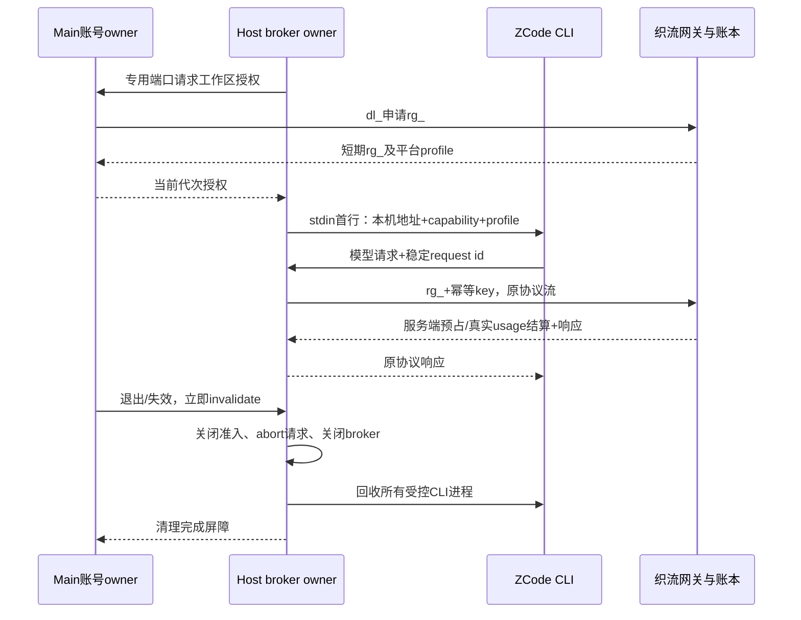

# 织流统一托管运行时

2026-10-21。先于实现定义；保留 ZCode Agent Loop、V4、工具、Skill 和 MCP，不开放个人模型配置。

## 所有者与可信启动

Main 独占系统安全存储中的 dl* 登录授权。Host 通过 Main 专用 MessagePort 请求短期 rg*；Main 每次检查当前账号代次，迟到授权撤销且不下发。rg\_ 只在 Host 内存，禁止写文件、日志、工具环境或 Renderer。Host 以工作区 identity 的 SHA256 为云端标识，不传本机路径。

Host 为每个工作区创建仅监听 127.0.0.1 随机端口的 HTTP broker，随机 capability。CLI 启动参数 `--managed-profile-stdin`，首行是严格校验的 profile；后续原 V4 NDJSON 不变。CLI 仅拿 broker 地址和本机 capability。profile 包含平台模型 alias、协议和上下文/输出上限；不含上游地址、Key、dl* 或 rg*。CLI 禁止从个人、项目和环境变量恢复模型配置，网络策略限定 broker，无重定向。

托管 Host 不装配或订阅官方账号 Provider 同步源；模型目录仅由可信首帧决定，CLI 继续拒绝 `provider/updateAccountConfig` 覆盖。首次登录验收必须等真实 CLI 完成启动和策略同步、Host 标记 model execution ready，再通过原生输入框完成一次模型请求；仅签发 runtime grant 不视为可用。上游异步目录水合可以接手预热，因此不依赖特定一次 `warmup ready` 日志。

原生输入框在织流账号已登录时挂载上游 Composer，保留附件、模式、插件和交互；未登录时显示账号提示。账号操作只向同一窗口广播失效信号，各视图从 Main 重读非秘密投影。Web relay 的原生会话输入不依赖桌面 Renderer 账号 Hook，继续使用已鉴权的 relay 会话。

## 授权与请求合同

`POST /api/desktop-auth/runtime-grants`，dl\_，body `{workspace_identity}`。Main 只接受固定 `/api/runtime-gateway/v1` 和严格 profile；15 分钟 grant 到期前 60 秒续期，single-flight。撤销使用 `DELETE /api/desktop-auth/runtime-grants/{id}`。Model alias 固定 `zhiliu-managed`，protocol 为 responses 或 chat_completions。模型、思考档位、渠道、报价和账本由服务端裁定。

2026-10-21 写记忆版本协商：本版本 Main 的 grant payload 固定增加 `platform_memory_write_capability: "forced_approval_and_execution_identity_v1"`，声明已随同发布的 CLI 具备强制逐次用户审批及稳定 session/turn 执行身份。该值仅由 Main 固定写入，不接受 Renderer、Agent/档位选择或环境配置输入。旧客户端缺失/null 的 grant 必须冻结只读；非法版本拒绝。此字段只做兼容协商，不是远程二进制证明，也不自行开启能力。服务端仍要求 grant snapshot、实时写开关、用户记忆开关和归属校验全部满足；当前写开关保持关闭。

broker 只接受带 capability 的 POST `/v1/responses` 或 `/v1/chat/completions`，且必须匹配平台 protocol。拒绝 Origin、异常 Host、无请求 ID、重定向和超大 body；Authorization 由 broker 换成 rg\_，不转发 Cookie/客户端认证头。每个模型调用以 ZCode 的 x-request-id 作为稳定 Idempotency-Key，重试保持该 key。主任务、子 Agent、标题、压缩均走相同模型 adapter 和 broker；不能信任客户端自报 usage。

## 生命周期与失败

账号退出、授权失效、Host 关闭同步停止新 admission；等待中的 grant/broker 创建受 generation 防护。退出屏障关闭 broker、取消在途并回收所有 chat/plugin/mcp-status CLI，之后允许新登录重新创建，不能永久 dispose services。服务端仍实时检查 grant 根撤销；断网不能使旧凭据重启执行。续期改变协议/限制时不让旧 CLI 静默改配置，要求重建运行时。

未授权或 profile 未就绪保持 fail-closed；服务目录只投影平台 profile。源源码保留本地能力不等同于已接通完整远控；现有文件桥和本批模型 broker 都不是完整 Host relay。

## 原能力入口与UI接线

织流品牌不再隐藏上游插件商店、Skill、MCP、Commands、自动化的设置入口，复用现有组件及其完整生命周期。此处只恢复入口，不新增另一套页面、服务或执行状态。插件和自动化实际调用仍受 Host 授权与统一托管模型准入控制，不能开放模型Key、上游地址或官方OAuth。UI遵循 DESIGN.md、CONTEXT.md 以及织流 UI 交接映射；工作区 identity 优先，保留来源空间、草稿和附件边界。

Host/Main 的专用端口须验证单工作区授权 single-flight、断开时同步关闭broker、迟到授权撤销、清理后重新登录可用。失效清理失败不得返回成功确认；端口关闭要捕获异步清理异常，防止未处理Promise泄漏。

## 验收

- dl*/rg*不进入 CLI 首帧、argv、env、Renderer、工具与日志；只有本机capability。
- 登录前拒绝CLI，登录后真实本地任务、工具/Skill/MCP可执行；没有Key或上游配置入口。
- 两协议、流/非流、子Agent与辅助调用均服务端扣费；重复调用不重复扣费。
- 非loopback/Origin/错误capability/路径/协议/请求ID拒绝，SSE中断传递取消。
- 同工作区并发只开一个broker/续期；退出与迟到创建、多个窗口、重新登录不复活旧身份。
- 根typecheck/lint/架构检查、定向单测与真实CLI网关链通过后开放。

# Desktop 平台目录与工作区选择（2026-10-22）

- Main 使用 native `dl_` 调用 `GET /api/desktop-auth/runtime-catalog`，严格解析 v1 的 Agent/profile UUID、名称和描述；Renderer 不接收真实模型、上游 URL、key、`dl_` 或 `rg_`。
- 通用对话和默认档位分别用 `agent_id=null`、`inference_profile_id=null`，不创建伪 UUID。平台决定套餐、企业分组/Agent 版本和模型路由，客户端目录仅为显示投影。
- 选择归属 `workspaceIdentity?.trim() || workspacePath`，Main 仅内存保存并随账号退出清空；发送服务前转成 `local:<sha256>`。选择更新先失效并等待对应工作区 Host broker/CLI 清理，不影响其他工作区；授权中的迟到响应必须撤销。旧 grant 不得续到新选择。
- 本期 Main 在存在任何进行中的本地任务时拒绝切换；UI同时禁用当前运行任务的选择器。该保守屏障避免同一项目不同标签页的闲置会话意外中断另一个运行任务；后续可在已有任务活动遥测提供可靠工作区粒度后缩小拒绝范围。
- 私有桥的 `invalidate` 可携带可选 workspace identity；未指定仍表示退出时全量撤销。Main 等 Host ack 后才承认新选择，任何清理失败保持拒绝屏障。
- Host 在同一 loopback listener 提供固定 `/mcp`，使用与模型独立的随机 capability，转发固定同源 `/api/runtime-gateway/mcp`。不缓存业务结果，不持久化 grant；注销/取消中止在途请求。工具调用必须透传 `tool:<原模型 toolCallId>` 幂等键，初始化/list 不伪造调用身份。
- 记忆写入在 CLI 强制审批闭环完成前不开放。读取能力仍经 SaaS 记忆开关、个人归属和原工具 ACL 校验。
