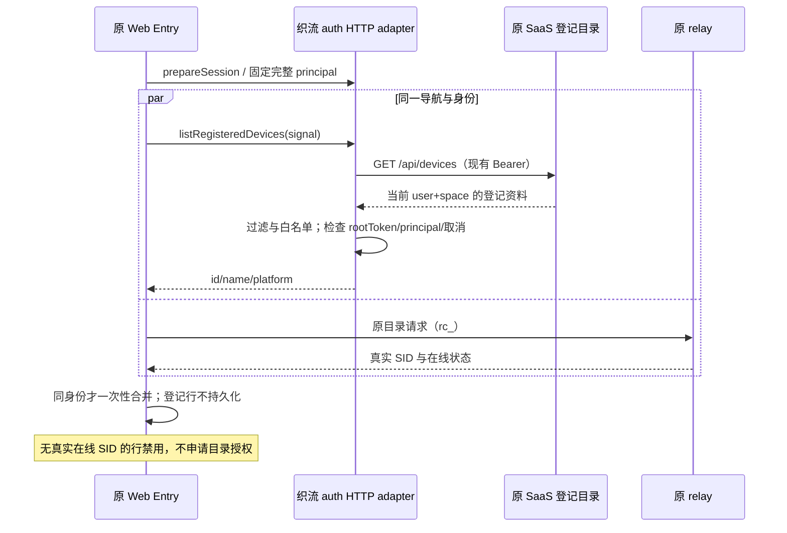
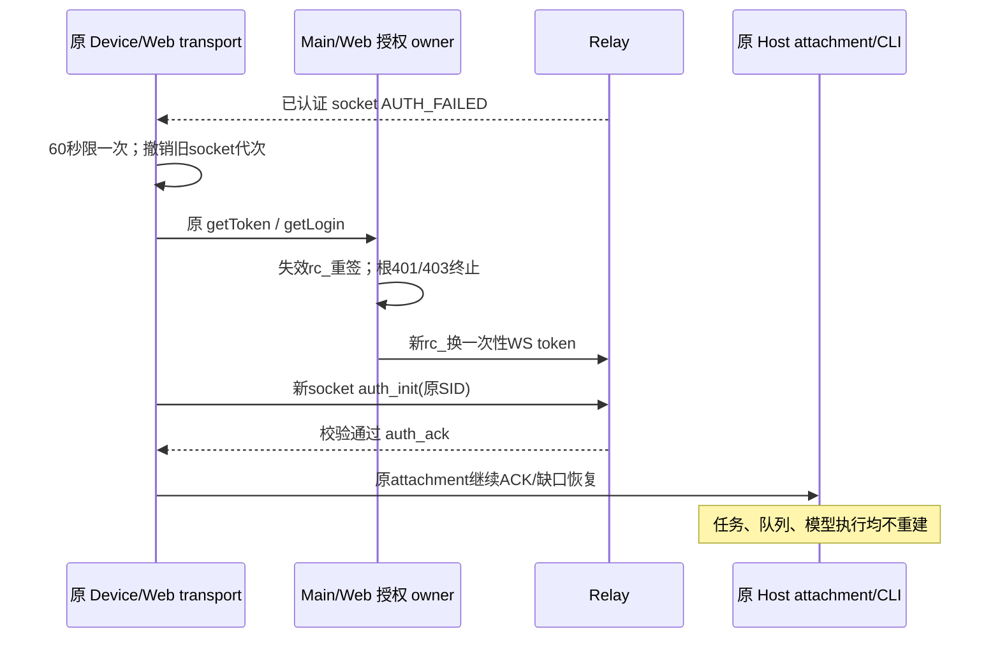
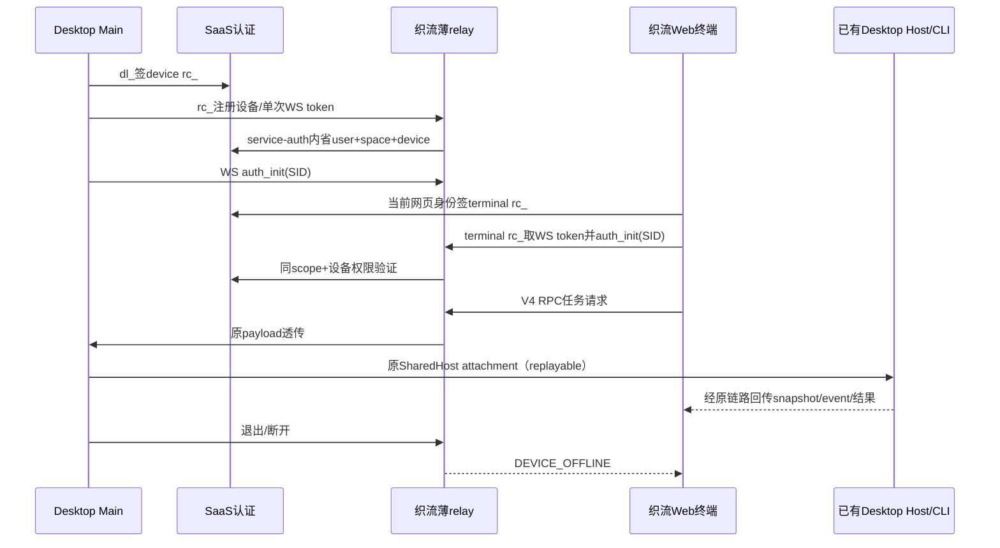

# 织流自有 Relay V2 与 Host attachment

2026-10-22。源码依据：`webRemoteControlManager.ts`、`webRemoteControlSharedHostAttachments.ts`、`packages/shared/src/web-remote-relay/contract.ts`、`docs/web-remote-control/relay-v2-pairing.md`。当前仓库的 `packages/server` 是本机/SSH Host，不包含上游生产 Go relay；本模块是织流实现的兼容薄 relay，不能宣称上游 Go 已复用部署。

## 所有者与认证

Main仍拥有dl\_与账号代次，Host仍拥有会话/任务/CLI；relay只拥有设备注册、一次性token、socket和同SID角色owner，不新增任务、消息历史或Agent队列。网页通过原V4 RPC attachment查看/发送本地任务，Agent依旧运行在已有Desktop Host。桌面continuous、网页replayable的订阅/补偿语义不变。

- Main：`POST /api/desktop-auth/relay-grants`，Bearer dl\_，`{device_mid}`。
- Web：`POST /api/desktop-relay/terminal-grants`，原网页账号上下文，`{desktop_device_id?: UUID}`；space来自当前上下文，不接受请求体改space。
- 两者响应严格为五字段：`{protocol_version:1,relay_grant:"rc_...",expires_at:ISO,principal_id:"<user_uuid>:<space_uuid>",desktop_device_id:UUID|null}`，5分钟且不超过根授权；device响应必须为当前native设备UUID。
- relay使用独立service Bearer调用固定内部 `POST /api/internal/desktop-relay/introspect`，body `{relay_grant}`。响应严格包含 `{protocol_version:1,principal_id,user_id,space_id,desktop_device_id:UUID|null,role:"device"|"terminal",device_mid:string|null,expires_at}`；失效401/403。每次检查根会话、设备、空间成员有效性，管理员无权读取他人私聊。
- device role必须带设备ID与MID，MID注册时完全匹配；terminal可限定目标desktop_device_id。设备注册记录按user+space+desktop_device_id绑定，不能只按user。principal_id必须等于user_id+":"+space_id。
- device rc*仅在Main/relay内存及授权HTTP头；不写二维码、Renderer、本地文件、日志。Web自行在内存持有terminal rc*，不能读取dl*或device rc*。

## V2 wire兼容

复用shared严格schema与路径：POST/GET `/api/v1/remote/device`，POST `/api/v1/remote/device/delete`，POST `/api/v1/remote/token`，WS `/api/v1/remote/ws2?token=...&mid=...`。HTTP成功信封 `{code:0,msg:"",data}`。设备字段 `{device_sid,device_mid,online,created_at:Unix秒,meta}`。token为16随机字节Base64URL、60秒、绑定rc\_身份与角色；升级前原子消费，重连须重取。拒绝role提升。

WS完全复用auth*init、pair_status_query、data与auth_ack、pair_status_ack、error、data。最大解压后1MiB，慢消费者累计发送缓冲上限4MiB，心跳15秒无输入/鉴权5秒超时关闭。每5秒重新内省有效性；撤销、过期、服务不可用均fail-closed，客户端换新rc*重连，Host任务不停。每条data同步检查本地过期状态，跨空间/用户/目标设备一律拒绝。内省每轮只允许一个在途请求，不积压。

同SID同role新连接取代旧owner，旧连接迟到close只按实例释放；device断开通知terminal DEVICE_OFFLINE并关闭，terminal断开仅通知device waiting。relay不解释data中的用户或任务ID，也不以payload重写认证身份。

## 增量上线和验收

### 织流网页终端身份适配

认证适配器由既有编译期开关 `ZHILIU_DESKTOP=1`（`ZHILIU_DESKTOP_ENABLED`）选择，不能由 URL、存储字段或服务端返回值切换。织流构建的远控只实例化并使用 SaaS terminal grant adapter；`/remote/v4` 上的官方 `state/code/authCode/error` 参数不得触发官方 OAuth callback，未登录仍走同源织流登录且返回地址移除这些参数。标准上游构建继续使用原 `WebAuthService`、登录页、回调 admission 与 dev-return 配置，不创建或请求织流授权。两种构建均复用同一个 V4 Entry 和恢复链路，不新增任务 owner。回归需同时验证上游回调/bridge 恢复，以及织流忽略本地旧 OAuth/native 凭据、仅以 SaaS Bearer 换取内存 terminal `rc_`；`dl_`、URL token 和官方 JWT 不能进入 relay 请求。

`packages/web` 保留原 V4 Entry、设备列表、bridgeSession、taskView、replay 和 Host attachment；不创建新 Agent。当前 SaaS 源码采用 sessionStorage `access_token/refresh_token` 加 HTTP Bearer，尚无 Cookie/CSRF 认证；本次沿用这一事实，不另造 Cookie 认证。织流 `/remote/v4` 以同标签页、同源现有 access*token 调用 `POST /api/desktop-relay/terminal-grants`，请求体为空对象，不接收 URL/body 中的 user/space 身份。响应严格校验 `protocol_version, relay_grant, expires_at, principal_id, desktop_device_id` 五字段，拒绝过期和非法 scope。`rc*`由 HTTP adapter 单一持有，仅存内存；Entry 使用 legacy`getZCodeJwtToken`端口传递此短期 relay 凭据，但不接入官方 OAuth、用户 Key 或本地 OAuth 仓库。access_token 过期仅通过原`/api/auth/refresh` 语义轮换已有 sessionStorage 字段，迟到 refresh 不可覆盖已退出/切换的 session。

adapter 在过期前 30 秒刷新，单请求在途且用代次丢弃 logout/dispose 后的迟到响应。相同 `principal_id` 和目标设备换凭据时，通过原 transport 的 suspend/recoverInBackground 关闭旧 socket、取新一次性 token、恢复既有 replayable attachment；不卸载任务 UI、不复制待执行队列。principal/目标设备变更必须撤销 Entry 导航代次并重新 admission，不能把旧设备列表/任务留给新空间。401 仅尝试一次原刷新端点；仍失败或 403 清内存授权并引导同源织流登录；网络故障不继续使用已失效凭据，原 transport 负责重连退避，服务端仍每 5 秒校验根授权。

### 同账号已登记设备发现

织流 Web 在同一次 Entry 导航中，通过可选 auth 端口读取原 SaaS `GET /api/devices`，与 relay 目录共同生成设备页。SaaS 继续拥有按 user+space 过滤的登记事实；relay 继续唯一拥有 SID 与在线连接。首次登录、没有任何浏览器设备缓存或尚未选择工作目录的客户端，只要已在当前账号和空间登记，即可显示；不创建虚构 SID、不自动授权目录、不新建 Host 或任务队列。

HTTP 仅由 `ZhiliuWebRelayAuth` 执行：固定同源路径、现有 access_token Bearer、`credentials:same-origin`、`cache:no-store`、`redirect:error`。响应最多接受 100 条，逐条校验 UUID、名称与平台长度，过滤撤销/非法记录，仅返回 id/name/platform，丢弃公钥、capabilities、online、workspace_ready 等字段。401 通过原单请求在途的身份刷新 owner 刷新一次并重试；网络/500 不清登录身份。取消、logout、dispose、rootToken 或完整 principal 变化后的旧响应不得进入设备页，也不得清理新账号身份。

Entry 在同一身份和 AbortSignal 下等待两份只读结果，再一次性合并。登记 ID 对应织流 relay MID；没有 relay 记录的设备产生空 `onlineConnections` 行，使用现有离线样式及“已登记，远控未连接”文案。元数据不表明设备当前在线；只有真实 relay 在线 SID 可以选择或自动连接。刷新替换当前结果，不累计登记行；撤销后不再返回的登记行随之移除。织流路径不读取/写入原跨账号的设备名缓存；登记信息仅属于本次内存投影。标准上游 auth 不提供此端口，保持原目录/缓存行为且不请求 SaaS。

回归覆盖：空浏览器缓存下首次发现、在线与登记合并不重复、刷新撤销移除、跨账号/空间迟到结果、401 单次刷新、500 保留登录与取消、metadata 不变成连接依据，以及上游构建零 SaaS 请求。受控浏览器交互场景只验证发现与禁用行，不替代真实客户端到 Host 的远控验收。

### 活跃 socket 的限次续签（真实验收回归）

已确认根因：Main 的 `authorizeRelay` 原本只在下一次 HTTP/建连时刷新 `rc_`；device socket 已配对或等待 terminal 时收到 300 秒过期 `AUTH_FAILED`，transport 直接终止 manager。Web 虽已有 -30 秒主动刷新，后台计时暂停也可能先收到过期错误。V2 error 不区分过期与撤销，因此不能把所有 `AUTH_FAILED` 当作过期无限重试。

transport 仅在本 socket 已收到且校验通过 `auth_ack` 后允许一次重新认证：关闭这一代 socket，保持 SID、manager runtime、Host attachment 与 RPC ACK/journal，由原 `getToken` 端口重新经过 Main/Web 授权 owner 和一次性 token HTTP，再建立下一代 socket。60 秒窗口内最多一次此恢复；恢复握手再次 `AUTH_FAILED`、参数错误及 HTTP 401/403均终止，不重注册、不继续尝试。下一次合法 `auth_ack` 只证明新 socket 认证；不能绕过 60 秒恢复预算。正常 300 秒凭据周期允许持续工作，等待 terminal 与运行任务都使用相同机制。未认证首次握手保留上游已有的单次 SID 重注册，但续签失败不得再落入此分支。

Main 签发端点 401/403 走既有账号 invalidation/Host teardown 屏障；迟到旧账号结果不能复活。Web 继续主动刷新，兜底重新认证仍由已有 SaaS 身份 owner 的 `prepareSession` 执行。socket generation 在关闭前递增；旧 close、ACK、HTTP 回包与 dispose/logout 之后的结果均不得推进新连接。续签不调用新建任务、不重放模型请求，不创建 CLI/Host 或第二队列；桌面 continuous 流不变，Web 通过原 replayable snapshot/gap/ACK 恢复。

自动回归覆盖 waiting/paired、两次300秒轮换、短时间重复AUTH_FAILED终止、续签401/403、dispose与迟到回包。最终联合验收需实际安装客户端和Web保持同一任务跨至少两个300秒边界，再发送/取消，并证明无重复账单、撤销设备及时断开；加速时钟测试不能替代这一证据。

凭据刷新、页面可见恢复、设备列表和连接 token 请求共用同一授权 owner。不新增持久凭据种类，只沿用 SaaS 现有 sessionStorage 身份字段及既有最近设备 SID/MID 展示偏好，不持久化 `rc_`、`dl_` 或上游 Key；错误只保留 auth-required/relay-unavailable 分类。登录返回地址限定当前 origin 的 `/remote/v4`，同标签页导航保留原 SaaS 身份，禁止跨 origin 传递 Token、URL 参数或 postMessage。验收包括同源 Bearer 签发、严格响应、并发去重、过期刷新、scope 切换、logout 迟到回包、取消、rc\_ 无存储和原 V4 连接恢复。

首次为单实例、内存设备目录；重启后已有客户端按上游AUTH_FAILED重注册并恢复attachment，不持久化消息。多实例扩容前必须把设备/token/owner原子操作移到共享存储；本版禁止无粘性多副本部署。反向代理使用同SaaS HTTPS origin、剥离token查询访问日志，不开放跨站CORS。部署配置只接受固定内省URL、service secret、监听地址与端口，启动检查。

验收覆盖HTTP/WS真实配对、双向透明传输、跨user/space/device拒绝、role提升拒绝、一次性token重放、过期/根撤销关闭、同role替换迟到close、离线恢复、无任务/CLI副本，以及Desktop登录/退出清理。完整网页接本地Host的真实Agent操作仍需联合E2E，不能用file桥或仅relay echo代替。

### 已运行的验证与发布条件

`zhiliuRelayManager.integration.test.ts` 使用真实自有relay HTTP/WS与原Main manager，验证native MID注册、设备目录在线状态、Web bootstrap、原shared Host attachment准入、双向V4 RPC、重复物理帧去重，以及退出后断开terminal并释放attachment。该测试的Host端使用受控MessagePort，不等于已通过真实安装程序到真实Host/模型的联合验收。原managerV2、HTTP、transport及Agent process/service共六文件249项回归通过；另有relay/Main/Host六文件102项通过。根typecheck通过，架构检查零新增违规，lint零错误。

当前服务器公开入口仍为开发HTTP，尚无已确认HTTPS域名；本次桌面开发包仅编入`http://127.0.0.1:18782`做受控本机smoke，不能作为公网远控已交付证据。生产构建仍要求可信HTTPS。确定域名后通过`ZHILIU_CLOUD_URL=https://<织流域名>`重新运行`pnpm build:zhiliu-desktop -- --os win --arch x64`，Main/Renderer/Installer共同采用同一构建身份，不向用户开放服务地址或模型Key设置。

上游开源树中的Computer Use包可为`zcodeCuaPlaceholder`占位实现。构建脚本只在检测到真实producer时暂存和打包Windows CUA Helper，因此保留源码入口不能证明包含上游闭源的任意桌面控制能力。浏览器、终端、文件、工具审批、插件和Host RPC沿用实际开源实现；缺少producer的能力保持fail-closed，后续需独立可维护实现或合法可用producer后再验收。

