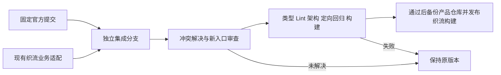

# ZCode 上游同步与织流适配

## 目标和固定输入

继续使用官方 ZCode 的 Agent、Host、插件和桌面基础能力，织流维护品牌与 SaaS 业务限制。
本轮输入：产品 `975db9e3aad0d558c95a1e91654dd03b06008e0c`，官方 `3c5b227649371507ddc4eb46ac5133afe6db1cab`（3.16.2），共同祖先 `aac4755666d09fdcd70272fcf063c077a639015f`。
使用独立集成分支，不覆盖旧安装包，不改织流 SaaS 或原始需求文档。

## 合并规则与所有者

- 上游负责桌面执行框架；保持新目录、状态机、协议和数据库迁移的唯一实现，不把旧整文件覆盖回去。
- 织流的品牌开关、Main 账号凭据、独立云窗、文件工具 attachment、journal/outbox 和 SaaS 权限继续遵循现有 `zhiliu-*.md` 合同。
- 新上游入口同样受织流限制：不展示或执行官方登录、BYOK、个人供应商配置、官方 relay 和官方更新。尚未接通的平台本地推理继续拒绝，不因为新增 CLI、插件、CUA 或 Source Server 入口而放行。
- Source Server 的连接、更新部署、直连 URL、自动重连和 Host remote attachment 均不是织流平台授权的替代；在托管远程推理接通前，实际执行入口必须在读取凭据或启动网络/进程前拒绝，UI 隐藏只作体验辅助。未开启织流构建时保留上游行为。
- 数据库启动重排采用上游模块路径，织流仅跳过尚未授权的 CLI session preparation；不能跳过 Host 自身库的迁移。
- 自动更新采用上游安装互斥和失败恢复，但来源、publisher 校验、安装开关仍由织流配置决定。
- 不改变账号授权代次、Host grant、目录授权、本机审批、结果外发确认、取消及迟到结果拒绝的语义。
- 上游新增架构准入规则追溯到了本轮前已提交的织流适配。仅对这些已存在文件按精确路径登记存量例外并说明所有者，不关闭规则、不刷新违规 baseline、不豁免目录；未来新增源文件仍须归属受管模块。

## 验收

1. 官方固定提交在产品分支历史中可追溯，原产品提交可回退；仅推送用户 fork。
2. 原织流授权、模型托管、云窗、文件工具、品牌、反馈和更新回归通过。
3. 上游新 Provider/登录/Source Server 入口不能绕过织流服务限制或读取其他品牌凭据。
4. 必须实际执行 typecheck、lint、架构检查及受影响测试；不把已有失败记为通过。
5. 打包和真实进程 smoke 单独记录；源码合并、构建、安装与线上发布分别报告。
6. 后续同步可以由命令创建集成分支并检查；有冲突必须停止自动发布，不能使用全局 ours/theirs 掩盖冲突。

## 同步命令

`pnpm sync:zhiliu-upstream` 只准备集成：核对官方 origin、拒绝脏工作树、fetch main、固定 SHA、创建同级 worktree 和独立分支，再执行不提交的合并。
已有上游祖先时不重复创建；同名目录或分支存在时拒绝覆盖。冲突保留在集成 worktree，源工作树不变。
支持 `--ref`、`--directory`、`--branch` 和 `--no-fetch`；后者用于固定已有对象及离线验证。
该命令不安装软件、不发布、不 push、不自动选择冲突方。通过检查后另行提交、发布，避免把“一键同步”误当无条件升级。
