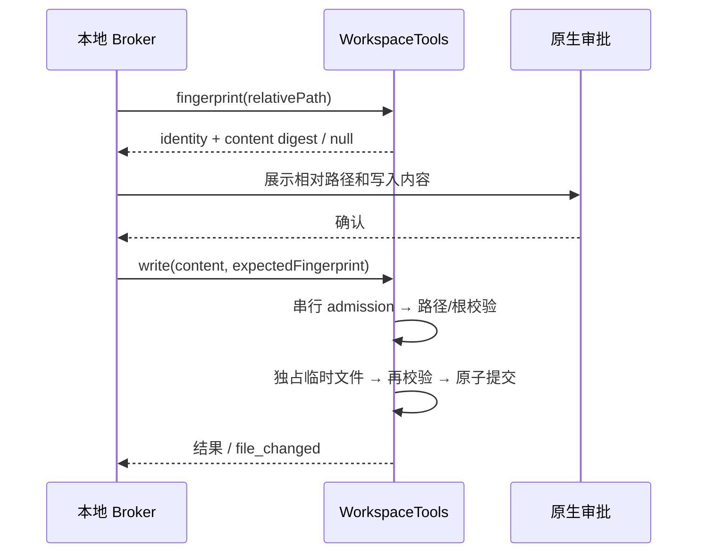

# 织流受控工作区文件工具

## 所有者与边界

本地原生目录选择器选择目录后，Host 创建一个 `WorkspaceTools`。该实例是根目录身份和本实例写入队列的唯一所有者；云端仅收到 `info` 中的显示名、文件工具能力和明确的隔离类型，不收到绝对路径。认证、设备/空间绑定、请求 journal、原生审批由调用层负责；本模块不启动 CLI、不执行模型或命令、不持有平台 Token。

首版只有 `file_read` 与 `file_write`。`terminalExec` 无条件拒绝，不能因审批通过而绕过；没有 OS 沙箱时不能宣称命令执行被隔离。文件策略名称为 `workspace-path-guard`，不是操作系统沙箱。

## 公共接口

- `WorkspaceTools.open(selectedPath)`：仅接受本机绝对路径的真实目录，拒绝磁盘根、用户主目录及其父目录、敏感目录和链接路径；保存根目录设备/inode 身份。POSIX 持有 no-follow 目录句柄，Linux 操作使用该句柄锚点。
- `info`：只读 `{name, capabilities: [file_read, file_write], terminalExec: false, isolation: workspace-path-guard}`，不含本地路径。
- `assertRoot()`：关闭、根目录替换、移动或链接化时拒绝。
- `fingerprint(relativePath)`：返回内容及文件身份/纳秒时间戳的摘要；目标不存在返回 `null`，但父目录必须存在并通过检查。
- `read(relativePath)`：返回相对路径、UTF-8 内容、字节数、SHA-256 与 fingerprint。
- `write(relativePath, content, expectedFingerprint)`：调用层在审批前取 fingerprint，审批后携带该值写入；同实例写入串行，入队后重新比较。目标变化则拒绝并要求重新审批。
- `close()`：撤销实例并释放句柄；调用层必须先停止并等待在途操作，再释放实例。
- `terminalExec(...)`：固定 `terminal_unavailable`。

## 文件访问规则

只允许根内既有普通文件，或既有真实父目录中的新文件，不自动创建目录。拒绝绝对路径、UNC、`..`、空段、ADS 冒号、控制字符、Windows 保留名和尾随点/空格；每层检查真实目录和真实路径，拒绝 symlink、junction、跨文件系统及多硬链接文件。敏感段包含 `.env` 及变体、`.ssh`、`.git`、凭据/密钥目录及常见密钥文件。

读取和写入均限制 64 KiB，拒绝无效 UTF-8、NUL 及二进制控制字节。读取使用有界缓冲，检查打开前、句柄和命名文件身份，读取后再次检查文件时间戳与目录链。

写入在同目录独占创建临时文件，写入并同步后重新校验根、目录链和 fingerprint。既有文件用 rename 替换目录项；新文件用 hard-link no-replace 提交，避免覆盖刚出现的文件；临时文件在成功和异常路径均清理。返回的 fingerprint 来自落盘后重新读取，不能把“写入内容 hash”当当前文件事实。

## 并发和真实限制

Node 没有跨平台的原子 compare-and-swap rename。既有文件最终校验与 rename 之间仍有本机恶意进程竞争窗口；Windows 也没有目录句柄相对 no-follow API，目录变动检查不能构成对抗同机恶意进程的安全隔离。Linux FD 锚点降低路径替换风险，但不能消除目标 CAS 竞争。不能把审批、路径守卫或 rename 原子性描述为 OS 沙箱。后续任意命令/不可信代码执行需要独立 OS 隔离执行器；该限制不通过开启上游 yolo/guarded 规避。

## 验收

正常 UTF-8 读、新建及经审批更新成功；info 不泄漏路径；路径穿越/UNC/ADS/Windows 保留名/敏感文件/二进制/超限/硬链接/目录链接拒绝。审批期间同内容替换、内容修改、根或父目录替换均拒绝；两个同旧 fingerprint 的写入只能成功一个。不存在的父目录不能创建；拒绝操作不得改变原文件且不得遗留临时文件。关闭后访问和所有终端请求拒绝。
